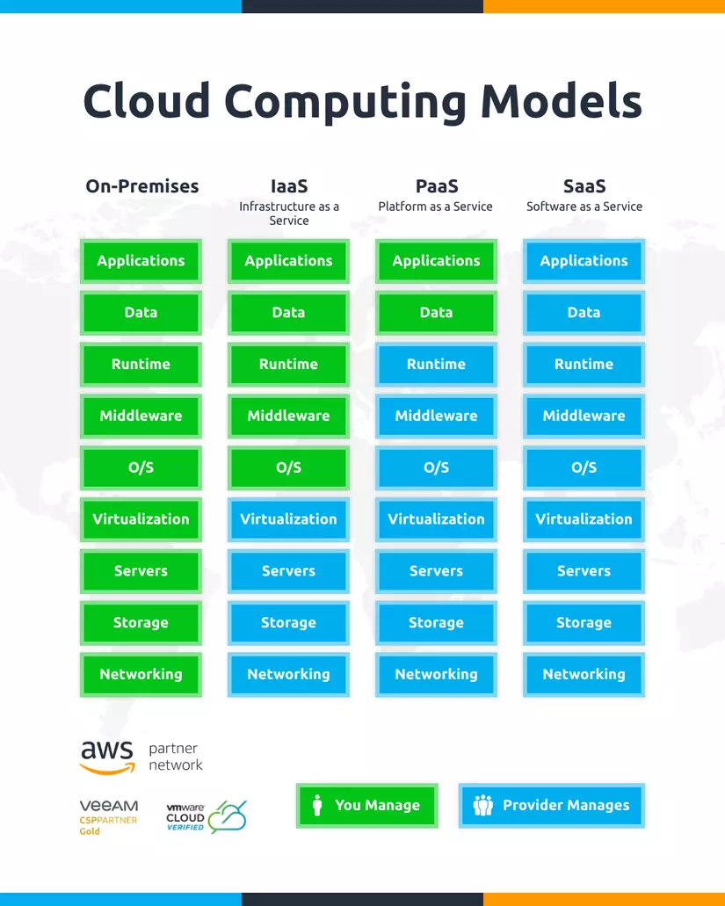

# Mục lục 

- [Mục lục](#mục-lục)
- [Tổng quan Cloud Computing](#tổng-quan-cloud-computing)
  - [I. Cloud Computing là gì ?](#i-cloud-computing-là-gì-)
  - [II. Đặc điểm của Cloud Computing](#ii-đặc-điểm-của-cloud-computing)
    - [2.0 On-demand self-service](#20-on-demand-self-service)
    - [2.1 Broad network access](#21-broad-network-access)
    - [2.2 Resource pooling](#22-resource-pooling)
    - [2.3 Rapid elasticity](#23-rapid-elasticity)
    - [2.4 Measured service](#24-measured-service)
  - [III. Mô hình triển khai](#iii-mô-hình-triển-khai)
    - [3.0 Public Cloud](#30-public-cloud)
    - [3.1 Private Cloud](#31-private-cloud)
    - [3.2 Hybrid Cloud](#32-hybrid-cloud)
    - [3.3 Community Cloud](#33-community-cloud)
  - [IV. Mô hình dịch vụ](#iv-mô-hình-dịch-vụ)
    - [4.0 IaaS - Infrastructure as a Service](#40-iaas---infrastructure-as-a-service)
    - [4.1 PaaS - Platform as a Service](#41-paas---platform-as-a-service)
    - [4.2 SaaS - Software as a Service](#42-saas---software-as-a-service)

# Tổng quan Cloud Computing 

## I. Cloud Computing là gì ? 

Cloud computing (điện toán đám mây) là mô hình cung cấp tài nguyên công nghệ như máy chủ, bộ nhớ lưu trữ, cơ sở dữ liệu và phần mềm qua Internet, để người dùng sử dụng theo nhu cầu mà không phải tự mua và vận hành toàn bộ hạ tầng 

## II. Đặc điểm của Cloud Computing 

### 2.0 On-demand self-service 

Khách hàng tự phục vụ, chủ động trong việc quản lý dịch vụ: khởi tạo, tạm dừng, gia hạn, ... dịch vụ không cần thông qua nhà cung cấp 

### 2.1 Broad network access 

Khả năng truy cập trên mọi nền tảng thiết bị, mọi nơi qua internet 

### 2.2 Resource pooling 

Khách hàng được cung cấp tài nguyên (pool) có thể sử dụng, phân chia tùy vào nhu cầu 

Khả năng gộm tài nguyên vật lý sau đó phân bổ 1 cách tự động cho người dùng theo nhu cầu 

**Ví dụ:** Khách hàng được cấp tài nguyên là 5 Core, 10GB RAM, 100GB DISK. Khách hàng có thể chia nhỏ sử dụng tùy nhu cầu: 
- Chia đều thành 5 máy: mỗi máy 1 Core, 2GB RAM,, 20GB DISK 
- Sử dụng một phần: 1 máy: 2 Core, 5GB RAM, 80GB DISK. Phần còn lại: 3 Core, 5GB RAM, 20GB DISK để dự trữ không sử dụng 

### 2.3 Rapid elasticity 

Khả năng co giãn linh hoạt, có thể cấp phát và thu hồi nhanh chóng theo nhu cầu khách hàng 

### 2.4 Measured service 

Khả năng đo lường mức sử dụng: chi phí thường tính theo tài nguyên và thời gian sử dụng 

## III. Mô hình triển khai 

### 3.0 Public Cloud 

Là mô hình trong đó hạ tầng được sở hữu và vận hành bởi nhà cung cấp dịch vụ, cung cấp tài nguyên cho nhiều khách hàng thông qua mạng. Các khách hàng dùng chung hạ tầng vật lý nhưng tài nguyên và dữ liệu được phân tách về mặt logic 

Mô hình này giúp giảm chi phí đầu tư ban đầu, triển khai nhanh và dễ dàng tăng hoặc giảm tài nguyên theo nhu cầu. Tuy nhiên, khách hàng có mức độ kiểm soát hạ tầng thấp hơn và phụ thuộc vào nhà cung cấp 

### 3.1 Private Cloud 

Là mô hình trong đó hạ tầng cloud được dành riêng cho một tổ chức. Hạ tầng có thể đặt tại Data Center, do tổ chức hoặc bên thứ 3 quản lý 

Mô hình này cho phép tổ chức chủ động kiểm soát tài nguyên, cấu hình hệ thống và áp dụng các chính sách bảo mật theo nhu cầu. Tuy nhiên, chi phí xây dựng, vận hành và bảo trì thường cao, đồng thời cần nhân sự có chuyên môn 

### 3.2 Hybrid Cloud 

Là mô hình kết hợp từ hai hoặc nhiều hạ tầng cloud riêng biệt, chẳng hạn private cloud và public cloud. Các hạ tầng vẫn hoạt động độc lập nhưng được kết nối bằng công nghệ cho phép trao đổi dữ liệu và dịch chuyển ứng dụng 

Mô hình này giúp tổ chức linh hoạt lựa chọn nơi xử lý và lưu trữ dữ liệu, đồng thời tận dụng khả năng mở rộng của public cloud. Tuy nhiên, việc tích hợp, đồng bộ dữ liệu và quản lý bảo mật giữa các môi trường phức tạp hơn 

### 3.3 Community Cloud 

Là mô hình trong đó hạ tầng cloud được sử dụng chung bởi một nhóm tổ chức có những yêu cầu tương đồng về nghiệp vụ. Hạ tầng có thể do một hoặc nhiều tổ chức quản lý, hoặc do bên thứ 3 vận hành 

## IV. Mô hình dịch vụ 

### 4.0 IaaS - Infrastructure as a Service 

IaaS cung cấp các tài nguyên hạ tầng như server ảo, network và storage. Người sử dụng có thể thuê các tài nguyên này để xây dựng và vận hành hệ thống theo nhu cầu 

Nhà cung cấp quản lý phần cứng và lớp ảo hóa. Người sử dụng chịu trách nhiệm quản lý hệ điều hành, môi trường chạy, ứng dụng và dữ liệu của mình.

### 4.1 PaaS - Platform as a Service 

PaaS cung cấp nền tảng để phát triển, triển khai và vận hành ứng dụng. Nền tảng này thường bao gồm hạ tầng, hệ điều hành, môi trường chạy và các công cụ hỗ trợ 

Nhà cung cấp quản lý hạ tầng cùng môi trường thực thi. Người sử dụng tập trung vào việc phát triển mã nguồn, quản lý ứng dụng, dữ liệu và các cấu hình được nền tảng cho phép 

Ưu điểm của PaaS là giảm công việc quản trị hệ thống và rút ngắn thời gian triển khai ứng dụng. Tuy nhiên, người sử dụng có ít quyền kiểm soát môi trường hơn và có thể phụ thuộc vào công nghệ của nền tảng.

### 4.2 SaaS - Software as a Service 

SaaS cung cấp phần mềm hoàn chỉnh qua mạng. Người sử dụng truy cập ứng dụng bằng trình duyệt hoặc ứng dụng khách mà không cần tự xây dựng và vận hành hệ thống phía máy chủ.

Nhà cung cấp quản lý hạ tầng, nền tảng và phần mềm. Người sử dụng chủ yếu quản lý tài khoản, dữ liệu đưa vào, quyền truy cập và các thiết lập trong phạm vi được cung cấp.