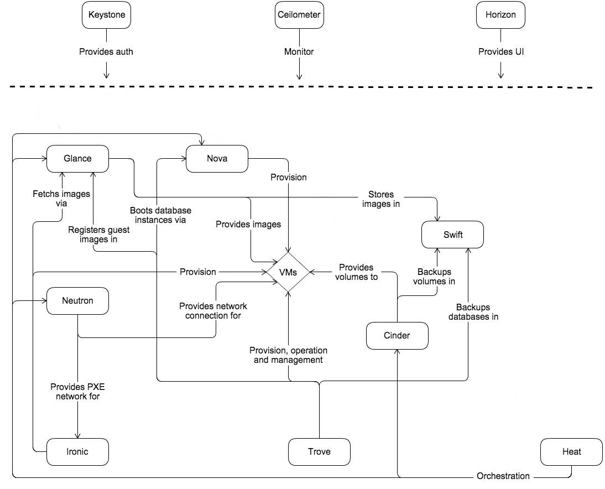
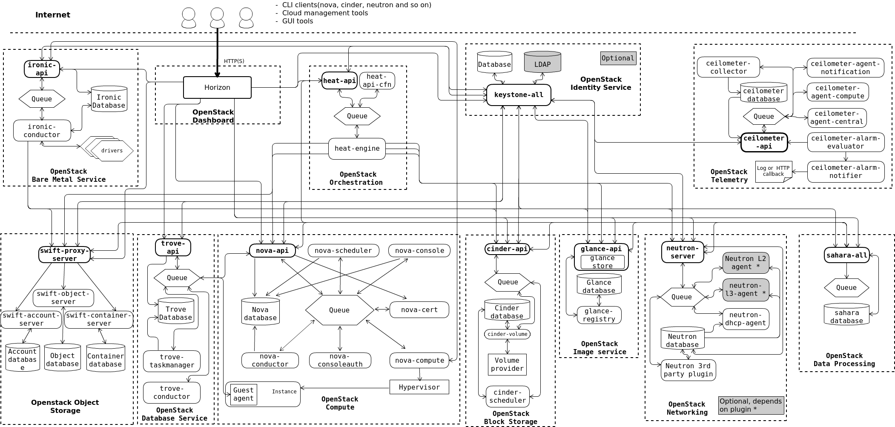

# Mục lục 

- [Mục lục](#mục-lục)
- [OpenStack](#openstack)
  - [The OpenStack architecture](#the-openstack-architecture)
    - [Conceptual Architecture (ý tưởng)](#conceptual-architecture-ý-tưởng)
    - [Logical Architecture](#logical-architecture)
- [Tài liệu tham khảo](#tài-liệu-tham-khảo)

# OpenStack 

Dự án OpenStack là một nền tảng điện toán đám mây mã nguồn mở dành cho tất cả các loại hình đám mây, với mục tiêu đơn giản hóa việc triển khai, mở rộng quy mô lớn và giàu tính năng. Các nhà phát triển và chuyên gia công nghệ điện toán đám mây từ khắp nơi trên thế giới cùng nhau tạo ra dự án OpenStack.

OpenStack cung cấp giải pháp Infrastructure as a Service(IaaS) thông qua một tập hợp các dịch vụ liên kết với nhau. Mỗi dịch vụ đều cung cấp một API giúp đơn giản hóa việc tích hợp này. Tùy thuộc vào nhu cầu có thể cài đặt một số hoặc tất cả các dịch vụ.

## The OpenStack architecture 

### Conceptual Architecture (ý tưởng) 

Mỗi quan hệ giữa các dịch vụ OpenStack: 

VMs là các máy ảo được tạo ra, chẳng hạn một máy Ubuntu dùng để chạy website. Để máy hoạt động, hệ thống cần cấp CPU/RAM, os, network vs volume. OpenStack chia những công việc này cho các dịch vụ riêng 

| Thành phần | Vai trò                         | Ví dụ                                    |
| ---------- | ------------------------------- | ---------------------------------------- |
| Nova       | Tạo và quản lý vòng đời máy ảo  | Tạo, bật, tắt, khởi động lại hoặc xóa VM |
| Glance     | Quản lý và cung cấp image       | Cung cấp image Ubuntu để khởi tạo VM     |
| Neutron    | Cung cấp kết nối mạng           | Tạo mạng, subnet, port, router cho VM    |
| Cinder     | Cung cấp volume - block storage | Tạo volume 100GB rồi gán vào VM          |

Nova phối hợp với các dịch vụ còn lại để tạo một VM hoàn chỉnh. Trong triển khai dùng KVM, Nova điều khiển việc tạo VM, còn KVM là hypervisor thực thi máy ảo trên compute node 

Glance, Cinder vs Swift lưu trữ những thứ khác nhau: 

- `Glance`: quản lý image - dùng để làm nguồn để tạo VM 
- `Cinder`: Block Storage - Gắn vào VM để os đọc/ghi như ổ cứng 
- `Swift`: Object Storage - file ảnh hoặc bản backup 

`Glance -> Swift: "Stores image in"`: Glance có thể dùng Swift làm nơi lưu dữ liệu image. Người dùng vẫn quản lý image qua Glance, Glance xử lý việc lưu và lấy dữ liệu ở phía sau. 

`Cinder -> Swift: "Backups volumes in"`: bản backup của volume có thể được lưu và swift. 

3 Thành phần có những chức năng dùng chung: 

- `Keystone - Provides auth`: Xác thực danh tính, cấp token và quản lý thông tin user, project, role để các dịch vụ kiểm tra quyền 
- `Horizon - Provides UI`: Cung cấp giao diện web để người dùng thao tác với OpenStack 
- `Ceilometer - Monitor`: Thu thập số liệu và sự kiện về việc sử dụng tài nguyên 

**Ví dụ:** Tạo một máy ubuntu có volume 100GB: 

1. Login Horizon, thông tin đăng nhập được xác thực qua Keystone 
2. Chọn image Ubuntu, cấu hình CPU/RAM và network rồi gửi yêu cầu tạo VM 
3. Nova tổ chức việc cấp phát VM trên compute node phù hợp 
4. Glance cung cấp image Ubuntu làm nguồi khởi tạo os 
5. Neutron cấp kết nối mạng cho máy 
6. Yêu cầu volume riêng, Cinder tạo volume 100GB để gắn vào VM 
7. Hypervisor trên compute node chạy VM

### Logical Architecture 

OpenStack bao gồm nhiều thành phần độc lập, được gọi là OpenStack service. Tất cả các service đều thực hiện xác thực thông qua 1 identity service dùng chung. Các service tương tác với nhau thông qua API công khai, ngoại trừ những trường hợp cần lệnh yêu cầu đặc quyền quản trị viên 

Bên trong mỗi OpenStack service bao gồm nhiều tiến trình. Tất cả service đều có ít nhất 1 tiến trình API, có nhiệm vụ lắng nghe các yêu cầu API, xử lý sơ bộ rồi chuyển đến các thành phần khác của service. 

1 Message Queue được sử dụng để trao đổi thông tin giữa các tiến trình trong cùng 1 dịch vụ. Trạng thái của dịch vụ được lưu trữ trong database. Khi triển khai và cấu hình OpenStack, có thể lựa chọn giữa nhiều giải pháp MQ và DB như RabbitMQ, MariaDB, ... 

Người dùng có thể truy cập OPS thông qua Web do Horizon Dashboard cung cấp, hoặc qua CLI, API. 

Kiến trúc OpenStack: 

Phía trên cùng là nơi người dùng đi vào hệ thống. Ta có thể sử dụng giao diện web Horizon hoặc CLI. 

Khối keystone cung cấp identity dùng chung: 
- Kiểm tra thông tin đăng nhập và cấp token 
- Quản lý user, project, role và danh mục địa chỉ API của các dịch vụ 
- Có thể kết nối với LDAP để sử dụng hệ thống tài khoản của tổ chức 

Khi gọi Nova hoặc Cinder, client gửi kèm token. Dịch vụ nhận yêu cầu kiểm tra danh tính và áp dụng chính sách quyền của mình. 

Khối Nova là phần trực tiếp quản lý máy ảo: 

- `nova-api`: Nhận và xử lý yêu cầu API về máy ảo 
- `nova-scheduler`: Chọn compute host phù hợp để chạy VM 
- `nova-conductor`: Phối hợp các tác vụ và làm trung gian cho những thao tác database từ compute 
- `nova-compute`: Làm việc với hypervisor để tạo, xóa, bật, tắt VM 
- `nova-database`: lưu thông tin quản lý VM và tài nguyên liên quan 
- `queue`: Truyền các lời gọi RPC giữa những tiến trình Nova 
- `Hypervisor -> Instance`: Với triển khai KVM, `nova-compute` thường điều khiển QEMU/KVM thông qua libvirt; hypervisor là lớp thực thi VM 

Ví dụ có 3 compute host A, B và C: 
- Scheduler chọn B dựa trên yêu cầu về tài nguyên 
- `nova-compute` trên B nhận cộng việc 
- Hypervisor trên B tạo và chạy VM 

`Nova database` lưu hồ sơ quản lý VM, chẳng hạn ID và trạng thái. Dữ liệu hệ điều hành, Website hoặc file bên trong VM nằm trên hệ thống lưu trữ phục vụ VM 

Các khối Glance, Neutron và Cinder cung cấp những tài nguyên Nova cần 

Ở Glance: 
- `glance-api`: tiếp nhận yêu cầu upload, tìm kiếm và tải image 
- `glance database`: lưu metadata: tên image, định dạng, kích thước, chủ sở hữu, ... 
- `glance store`: là lớp truy cập backend chứa dữ liệu image 

Ví dụ với image Ubuntu, thông tin mô tả image nằm trong database, còn nội dung file image nằm ở backend lưu trữ 

Ở Neutron: 
- `neutron-server`: Nhập API quản lý netowrk, subnet, port, router 
- `Plugin/driver`: Kết nối yêu cầu của Neutron với công nghệ mạng bên dưới 
- `L2 agent`: Thiết lập kết nối mạng lớp 2 trên các host 
- `L3 agent`: Thực hiện các chức năng router và NAT 
- `DHCP agent`: Cung cấp dịch vụ DHCP cho máy ảo 
- `neutron database`: lưu cấu hình và trạng thái mạng 

Ở Cinder, luồng tạo volume được chia thành 3 vai trò: 
- `cinder-api`: nhận yêu cầu tạo volume 
- `cinder-scheduler`: chọn backend lưu trữ phù hợp 
- `cinder-volume`: dùng driver để yêu cầu Volume provider tạo volume 

`Volume provider` có thể là Ceph RBD, LVM hoặc hệ thống lưu trữ được hỗ trợ.

Swift phục vụ object storage: 
- `swift-proxy-server`: tiếp nhận yêu cầu và định tuyến đến nơi lưu phù hợp 
- `swift-object-server`: lưu và phục hồi nội dung object 
- `swift-container-server`: quản lý danh sách object trong container 
- `swift-account-server`: quản lý danh sách container trong account 

Những khối còn lại: 

- `Heat - Orchestration`: API nhận template, `heat-engine` đọc quan hệ tài nguyên rồi gọi API Nova, Neutron, Cinder, ... để triển khai hệ thống 
- `Ironic - Bare Metal`: `ironic-api` nhận yêu cầu; `ironic-conductor` dùng driver để quản lý và triển khai máy chủ vật lý
- `Trove - Database Service`: 	API nhận yêu cầu database; taskmanager tổ chức triển khai; conductor nhận thông tin trạng thái từ instance
- `Telemetry`: 	Các agent thu thập dữ liệu/sự kiện; các thành phần xử lý và cảnh báo sử dụng dữ liệu đó

`Heat` điều phối bằng cách gọi API của các dịch vụ tương ứng

**Quy trình tổng quan khi provisioning VM:** 

- `Bước 1`: Client xác thực với Keystone và lấy token 
  - Keystone kiểm tra thông tin xác thực. Các dịch vụ tiếp theo gửi kèm token. Mỗi dịch vụ áp dụng chính sách quyền đối với thao tác được yêu cầu 
- `Bước 2`: Người dùng chọn cấu hình, client gửi yêu cầu tạo server đến Nova 
  - Khi bấm Launch Instance, Horizon gửi yêu cầu đến `nova-api`
- `Bước 3:` Nova kiểm tra yêu cầu và ghi nhận công việc cần thực hiện 
  - Nova kiểm tra quyền, quota, flavor sau đó công việc được chuyển tới conductor qua rabbitMQ 
  - Conductor tổ chức quy trình xây dựng VM và yêu cầu scheduler chọn nơi chạy 
- `Bước 4`: Scheduler chọn compute host
- `Bước 5`: Conductor gửi lệnh build đến đùng `nova-compute`
- `Bước 6`: Nova yêu cầu Neutron cấp và bind port cho VM 
  - nova-compute -> HTTP REST -> neutron-server 
  - Neutron quản lý các thông tin như: 
    - `Port ID`: port-web-01
    - `Network`: private-net 
    - `MAC`: MAC của card mạng ảo 
    - `Fixed IP`: 10.0.0.10
    - `Device ID`: UUID của VM 
    - `Binding host`: compute-02
    - `Security groups`
- `Bước 7`: Compute chuẩn bị image 
  - nova-compute -> Glance API -> image store 
- `Bước 8`: Cinder chuẩn bị volume dữ liệu 100GB 
  - `cinder-scheduler`: chọn backend phù hợp 
  - `cinder-volume`: dùng driver thao tác trên backend đó 
- `Bước 9`: Libvirt dựng cấu hình VM 
  - nova-compute -> libvirt -> KVM 
- `Bước 10`: guest OS boot, nhận cấu hình và chạy. Nova cập nhật trạng thái 

# Tài liệu tham khảo 

https://docs.openstack.org/install-guide/get-started-with-openstack.html