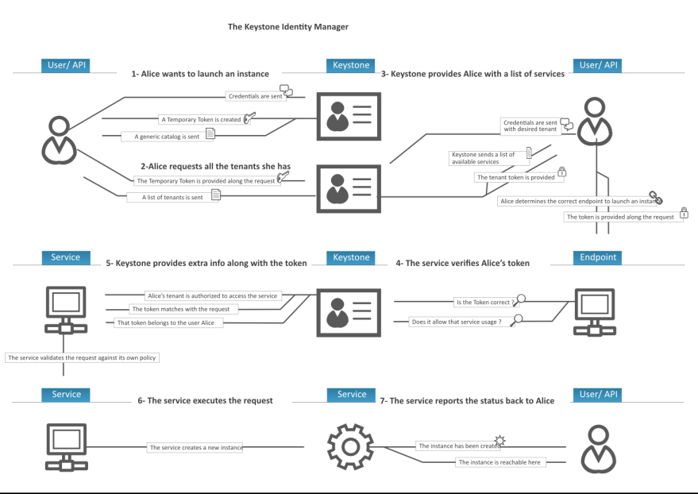

# Mục lục 

- [Mục lục](#mục-lục)
- [Luồng làm việc của Keystone](#luồng-làm-việc-của-keystone)
  - [I. Alice muốn tạo máy ảo -\> đăng nhập vào keystone](#i-alice-muốn-tạo-máy-ảo---đăng-nhập-vào-keystone)
  - [II. Alice yêu cầu danh sách các project mình có thể truy cập](#ii-alice-yêu-cầu-danh-sách-các-project-mình-có-thể-truy-cập)
  - [III. Alice chọn project -\> Keystone cấp project-scoped token và service catalog](#iii-alice-chọn-project---keystone-cấp-project-scoped-token-và-service-catalog)
  - [IV. Nova kiểm tra token của Alice](#iv-nova-kiểm-tra-token-của-alice)
  - [V. Keystone trả thông tin Token -\> Nova kiểm tra policy của mình](#v-keystone-trả-thông-tin-token---nova-kiểm-tra-policy-của-mình)
  - [VI. Nova thực hiện yêu cầu tạo máy ảo](#vi-nova-thực-hiện-yêu-cầu-tạo-máy-ảo)
  - [VII. Nova trả kết quả cho Alice](#vii-nova-trả-kết-quả-cho-alice)


# Luồng làm việc của Keystone 



## I. Alice muốn tạo máy ảo -> đăng nhập vào keystone 

Alice gửi credential đến Keystone. Keystone kiểm tra danh tính và cấp token xác thực thành công. 

- `unscoped token`: chứng minh Alice đăng nhập, nhưng chưa xác định Alice đang thao tác trong project nào 

## II. Alice yêu cầu danh sách các project mình có thể truy cập 

Alice dùng token vừa nhận để hỏi keystone: 

> "Tôi có thể làm việc trong những project nào ?"

Trong API v3 có thể gọi: 

```http
GET /v3/auth/projects
X-Auth-Token: <unscoped-token>
```

Keystone có thể trả về những project mà Alice có thể lấy token scoped vào, dựa trên các role assignment của Alice. Đây không nhất thiết là những project do Alice tạo ra hay sở hữu 

Ví dụ kết quả có: `project-dev` và `project-test` -> Alice chọn `project-dev`

## III. Alice chọn project -> Keystone cấp project-scoped token và service catalog

Alice gửi yêu cầu lấy token cho `project-dev`. Alice có thể dùng unscoped token làm phương thức xác thực, không cần nhập lại mật khẩu 

Keystone kiểm tra quyền của ALice trên project rồi cấp `project-scoped token`. Thông tin gắn với token lúc này thể hiện: 

- Người dùng: Alice
- Project đang làm việc: `project-dev`
- Các role của Alice trong project đó 
- Thời điểm hết hạn 

Phản hồi thường kèm service catalog để client tìm endpoint phù hợp

Để tạo máy ảo, client chọn endpoint của dịch vụ Compute - Nova, rồi gửi yêu cầu tạo instance kèm token: 

```http
POST <nova-endpoint>/servers
X-Auth-Token: <project-scoped-token>
```

Từ đây, yêu cầu tạo máy ảo được gửi trực tiếp đến Nova. 

## IV. Nova kiểm tra token của Alice 

Endpoint là Nova API 

Khi nhận request, middleware xác thực của Nova lấy token trong header và xác minh token

Câu hỏi ở bước này là: 

> "Token này có hợp lệ không, và nó đại diện cho danh tính cùng phạm vi nào?" 

## V. Keystone trả thông tin Token -> Nova kiểm tra policy của mình 

Keystone trả thông tin gắn với token, chẳng hạn user, project, role và thời hạn. Sau đó, Nova dùng policy của Nova để quyết định Alice có được tạo máy ảo hay không. 

Ví dụ: role của Alice trong `project-dev` có đáp ứng policy cho thao tác tạo instance không ? 

| Kiểm tra                                                                | Thành phần chịu trách nhiệm     |
| ----------------------------------------------------------------------- | ------------------------------- |
| Alice là ai, token có hợp lệ, có những role nào trong scope nào?        | Keystone và middleware xác thực |
| Với danh tính, scope và role đó, Alice có được thực hiện API này không? | Nova                            |

## VI. Nova thực hiện yêu cầu tạo máy ảo 

Nếu được phép, Nova kiểm tra các điều kiện như quota và tài nguyên, rồi điều phối quá trình tạo instance trên compute node.

Keystone đã cung cấp thông tin xác thực cần thiết; quá trình tạo instance thuộc trách nhiệm của Nova và các dịch vụ liên quan.

## VII. Nova trả kết quả cho Alice 

Hình đơn giản hóa bước này thành “máy ảo đã được tạo”.

Thực tế, tạo instance là thao tác bất đồng bộ: Nova thường trả `202 Accepted` cùng ID của instance trước khi quá trình tạo hoàn tất. Client tiếp tục gọi API lấy trạng thái để biết instance đã `ACTIVE` hay gặp lỗi.

