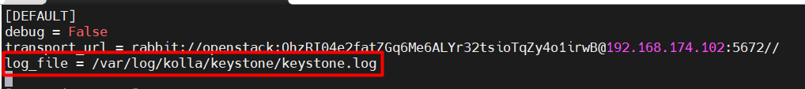
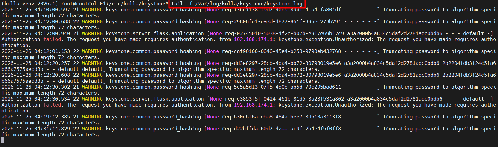

# Mục lục 

- [Mục lục](#mục-lục)
- [File log của Keystone](#file-log-của-keystone)
  - [I. Xem vị trí log của keystone](#i-xem-vị-trí-log-của-keystone)
  - [II. File log keystone](#ii-file-log-keystone)
  - [III. Ba kiểu định dạng log](#iii-ba-kiểu-định-dạng-log)
    - [3.0 formatter\_minimal](#30-formatter_minimal)
    - [3.1 formatter\_normal](#31-formatter_normal)
    - [3.2 formatter\_debug](#32-formatter_debug)
  - [IV. Cấu trúc tổng quát của `/etc/keystone/logging.conf`](#iv-cấu-trúc-tổng-quát-của-etckeystoneloggingconf)


# File log của Keystone 

Keystone ghi log tại `/var/log/keystone/keystone.log`. Cấu hình logging qua `logging.conf`

## I. Xem vị trí log của keystone 

Khi cài đặt OPS bằng kolla-ansible, check file config của keystone để xem vị trí log: 

```bash
vi /etc/kolla/keystone/keystone.conf
```



## II. File log keystone 

Ở đây, keystone lưu file log tại: `/var/log/kolla/keystone/keystone.log`: 



Các option hữu ích: 

| Option                | Mô tả                                                        | Note                                      |
| --------------------- | ------------------------------------------------------------ | ----------------------------------------- |
| `insecure_debug=true` | Log hiển thị thông tin nhạy cảm (lý do xác thực thất bại...) | Chỉ dùng khi debug, không dùng production |
| `--debug`             | Chạy Keystone ở chế độ debug                                 | Dùng khi không thấy request nào trong log |
| `use_syslog = true`   | Gửi log qua syslog                                           | Đặt trong phần `[DEFAULT]`                |

## III. Ba kiểu định dạng log 

Formatter quyết định mỗi dòng log hiển thị những thông tin gì.

| Formatter | Thông tin hiển thị                       | Khi nào dùng                   |
| --------- | ---------------------------------------- | ------------------------------ |
| `minimal` | Chỉ nội dung message                     | Log rất gọn, ít dùng           |
| `normal`  | Tên logger + Thời gian + Level + Message | Chạy production (INFO/WARNING) |
| `debug`   | normal + tên file + tên hàm              | Troubleshoot sâu (DEBUG)       |

### 3.0 formatter_minimal 

```bash
format=%(message)s
```

- Chỉ ghi nội dung thông báo thuần túy.
- Không có thời gian, không có level, không có tên module.

### 3.1 formatter_normal

```bash
format=(%(name)s): %(asctime)s %(levelname)s %(message)s
```

- `%(name)s`: Tên logger. Ví dụ: `keystone`, `keystone.api`
- `%(asctime)s`: Thời gian xảy ra. Ví dụ: `2026-04-15 15:30:45,123`
- `%(levelname)s`: Mức độ log. Ví dụ: `DEBUG`, `INFO`, `WARNING`, `ERROR`
- `%(message)s`: Nội dung thông báo. Ví dụ: `Token validated successfully`

### 3.2 formatter_debug

```bash
format=(%(name)s): %(asctime)s %(levelname)s %(module)s %(funcName)s %(message)s
```

Thêm 2 trường so với normal: 

- `%(module)s`: Tên file Python
- `%(funcName)s`: Tên hàm đang chạy 

## IV. Cấu trúc tổng quát của `/etc/keystone/logging.conf`

```bash
[formatters]   → Khai báo tên các formatter
[handlers]     → Khai báo nơi ghi log (file, console, syslog...)
[loggers]      → Cấu hình mức log cho từng logger cụ thể
[logger_root]  → Logger gốc – mức log mặc định cho toàn bộ Keystone
```

**Ví dụ cấu hình điển hình:**

```INI
[formatters]
keys=minimal, normal, debug

[formatter_minimal]
format=%(message)s

[formatter_normal]
format=(%(name)s): %(asctime)s %(levelname)s %(message)s

[formatter_debug]
format=(%(name)s): %(asctime)s %(levelname)s %(module)s %(funcName)s %(message)s

[handlers]
keys=console, file

[handler_file]
class=handlers.WatchedFileHandler
level=INFO
formatter=normal
args=('/var/log/keystone/keystone.log', 'a')

[logger_root]
level=INFO
handlers=file
```