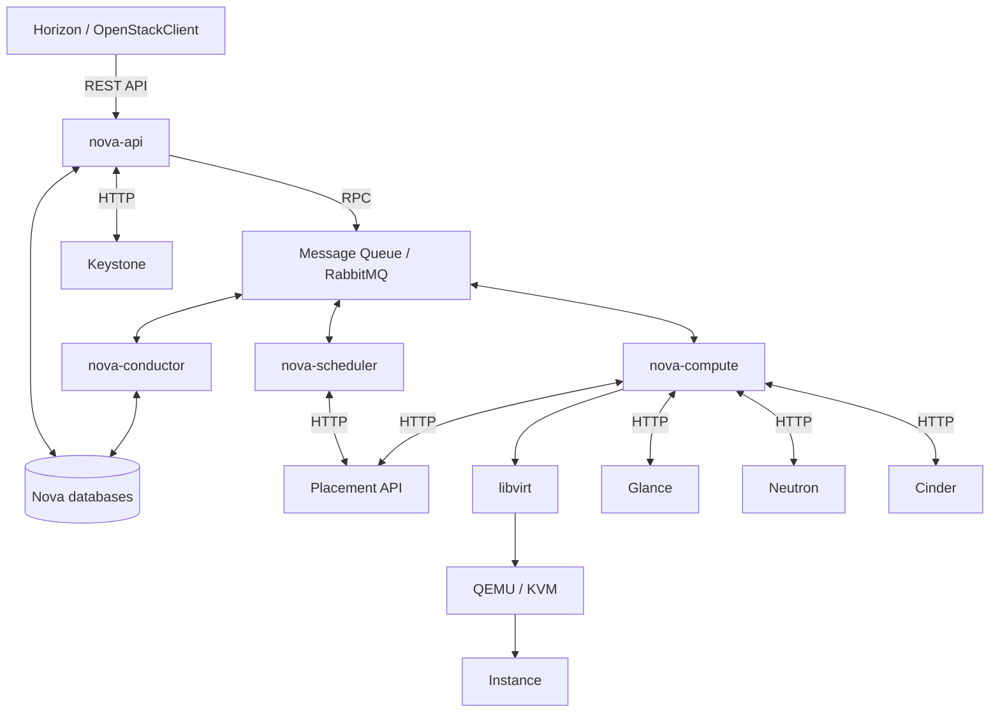
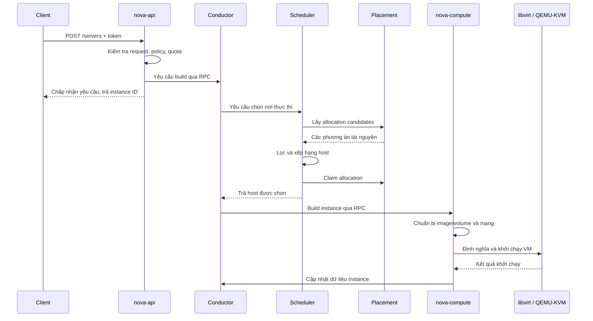

# Mục lục

- [Nova Architecture](#nova-architecture)
  - [I. Tổng quan kiến trúc](#i-tổng-quan-kiến-trúc)
  - [II. Các thành phần chính](#ii-các-thành-phần-chính)
  - [III. Cách các thành phần giao tiếp](#iii-cách-các-thành-phần-giao-tiếp)
  - [IV. Cells v2 và database](#iv-cells-v2-và-database)
  - [V. Luồng khởi tạo một instance](#v-luồng-khởi-tạo-một-instance)
  - [VI. Metadata và console](#vi-metadata-và-console)
  - [VII. Liên hệ với triển khai Kolla-Ansible](#vii-liên-hệ-với-triển-khai-kolla-ansible)
- [Tài liệu tham khảo](#tài-liệu-tham-khảo)

# Nova Architecture

## I. Tổng quan kiến trúc

Nova gồm nhiều tiến trình dịch vụ, mỗi thành phần đảm nhiệm một phần công việc. Compute API tiếp nhận HTTP request; các dịch vụ nội bộ sử dụng RPC qua message queue để điều phối tác vụ.

Trong mô hình thường gặp:

- **Controller** chạy các dịch vụ API, scheduler và conductor.
- **Compute node** chạy `nova-compute`, libvirt và QEMU/KVM để thực thi VM.
- **Database** lưu trạng thái; **message queue** vận chuyển thông điệp giữa các dịch vụ.

Vị trí triển khai có thể thay đổi theo quy mô. Mô hình all-in-one đặt nhiều vai trò trên cùng một máy. Xem [Nova System Architecture](https://docs.openstack.org/nova/latest/admin/architecture.html).

Sơ đồ dưới đây mô tả các quan hệ chính của một triển khai đơn giản; các đường RPC đi qua message queue.



Sơ đồ lược bớt các lời gọi dịch vụ phụ thuộc từ API và conductor để dễ theo dõi.

## II. Các thành phần chính

### 2.1. nova-api

Tiếp nhận Compute API request, xác thực token qua middleware, kiểm tra policy và dữ liệu đầu vào. Với tác vụ dài như tạo VM, API tiếp nhận yêu cầu rồi chuyển xử lý sang các dịch vụ phía sau.

### 2.2. nova-scheduler

Chọn compute host phù hợp. Scheduler lấy allocation candidates từ Placement, áp dụng filters và weighers, rồi thực hiện claim tài nguyên cho lựa chọn được dùng. **Filters** loại host không đáp ứng yêu cầu; **weighers** xếp hạng những host còn lại. Xem [Compute schedulers](https://docs.openstack.org/nova/latest/admin/scheduling.html).

### 2.3. nova-conductor

Điều phối các tác vụ như build và resize, xử lý truy cập database thay cho compute và chuyển đổi các object khi cần. `nova-compute` truy cập dữ liệu qua conductor thay vì kết nối trực tiếp Nova database.

### 2.4. nova-compute

Chạy trên compute node, sử dụng compute driver để tạo và quản lý instance. Với libvirt driver, nó chuẩn bị đĩa, kết nối mạng và volume, rồi yêu cầu libvirt khởi chạy VM. Xem [các thành phần Nova](https://docs.openstack.org/nova/latest/admin/architecture.html#components).

### 2.5. Placement

Placement là dịch vụ riêng, lưu mô hình tài nguyên để phục vụ cấp phát:

| Khái niệm | Ý nghĩa |
|---|---|
| Resource provider | Nơi cung cấp tài nguyên, ví dụ một compute node |
| Inventory | Lượng tài nguyên provider công bố |
| Resource class | Loại tài nguyên định lượng, ví dụ `VCPU`, `MEMORY_MB`, `DISK_GB` |
| Allocation | Tài nguyên đã cấp cho consumer, thường là instance |
| Trait | Đặc tính định tính của provider, ví dụ khả năng phần cứng |

`nova-compute` báo cáo inventory và khả năng tài nguyên. Allocation ghi nhận phần đã cấp, giúp các yêu cầu sau tránh cấp phát vượt capacity. Placement không đo mức CPU đang bận như một hệ thống giám sát hiệu năng. Xem [Placement](https://docs.openstack.org/placement/latest/).

## III. Cách các thành phần giao tiếp

| Cơ chế | Dùng để làm gì? | Ví dụ |
|---|---|---|
| HTTP / REST | Gọi API dịch vụ | Client → Nova; Scheduler → Placement |
| RPC qua message queue | Chuyển yêu cầu giữa các dịch vụ Nova | Conductor → Compute |
| SQL | Đọc và cập nhật dữ liệu bền vững | Conductor → Cell database |
| Driver / libvirt API | Điều khiển hypervisor | Compute → libvirt → QEMU/KVM |

RabbitMQ là broker thường dùng trong triển khai Kolla. Message queue lưu thông điệp xử lý; trạng thái nghiệp vụ của instance được lưu trong database. Xem [kiến trúc giao tiếp Nova](https://docs.openstack.org/nova/latest/admin/architecture.html).

## IV. Cells v2 và database

**Cells v2** chia hệ thống thành các cell để mở rộng quy mô. Một triển khai nhỏ vẫn cần cấu trúc cells:

| Database | Vai trò |
|---|---|
| API database | Dữ liệu cấp API, bao gồm thông tin ánh xạ tới cell |
| Cell0 database | Lưu instance thất bại trước khi được lập lịch vào cell thực thi |
| Cell database, ví dụ cell1 | Lưu dữ liệu instance của cell có compute host |

Cell0 không có compute host và không chạy VM. Trong mô hình nhiều cell, mỗi cell thực thi có database, message queue và conductor riêng; API và scheduler nằm ở cấp toàn cục. Có thêm super conductor để điều phối ở cấp API.

Tên database thực tế do hệ thống triển khai đặt. Xem [Cells v2 — Service layout và Databases](https://docs.openstack.org/nova/latest/admin/cells.html).

## V. Luồng khởi tạo một instance

Ví dụ người dùng gửi `openstack server create`. Luồng dưới đây mô tả các bước chính của một lần build thành công; chi tiết chuẩn bị đĩa và mạng thay đổi theo backend.



Conductor phối hợp đưa yêu cầu đến cell và compute phù hợp. Compute sử dụng Glance, Neutron và Cinder theo cấu hình VM, sau đó gọi driver để spawn instance. Phần chọn host dựa trên [Compute schedulers](https://docs.openstack.org/nova/latest/admin/scheduling.html); vai trò điều phối và thực thi được mô tả trong [Nova System Architecture](https://docs.openstack.org/nova/latest/admin/architecture.html).

Việc trả về HTTP thành công ở bước đầu chỉ xác nhận API đã tiếp nhận yêu cầu. Build có thể lỗi sau đó; cần xem `server show`, event và log để biết kết quả. Xem [Compute API — Faults](https://docs.openstack.org/api-guide/compute/faults.html).

## VI. Metadata và console

### 6.1. Metadata API

Metadata API cung cấp thông tin riêng của instance và user-data. VM thường truy cập tại `http://169.254.169.254`; Neutron hỗ trợ chuyển tiếp và xác định instance nguồn. Đường đi cụ thể phụ thuộc networking backend.

Cloud-init bên trong guest sử dụng dữ liệu này để cấu hình lúc boot. Xem [Metadata service](https://docs.openstack.org/nova/latest/admin/metadata-service.html).

### 6.2. Console proxy

Với noVNC, người dùng lấy console URL qua API rồi mở bằng trình duyệt. `nova-novncproxy` xác thực console token và chuyển tiếp kết nối tới VNC server của instance trên compute host.

```text
Browser → nova-novncproxy → VNC server của QEMU → Màn hình VM
```

Console không đi qua IP mạng của guest nên hữu ích khi VM lỗi mạng. Đường kết nối tới proxy và compute vẫn phải hoạt động. Xem [Configure remote console access](https://docs.openstack.org/nova/latest/admin/remote-console-access.html).

## VII. Liên hệ với triển khai Kolla-Ansible

Kolla đóng gói các dịch vụ vào container. Với Docker, có thể quan sát trên từng node:

```bash
sudo docker ps --format 'table {{.Names}}\t{{.Status}}'
openstack compute service list
openstack hypervisor list
```

Các tên thường gặp gồm `nova_api`, `nova_scheduler`, `nova_conductor`, `nova_compute`, `nova_libvirt`, `nova_novncproxy`. Thành phần xuất hiện tùy vai trò node và cấu hình console. Container đang chạy chỉ phản ánh một lớp trạng thái; cần đối chiếu thêm service heartbeat và log. Xem [Kolla troubleshooting](https://docs.openstack.org/kolla-ansible/latest/user/troubleshooting.html).

Đọc tiếp [Nova File log](03.Nova_file_log.md) để xác định cần xem file nào khi một bước trong luồng build gặp lỗi.

# Tài liệu tham khảo

- [Nova System Architecture](https://docs.openstack.org/nova/latest/admin/architecture.html)
- [Cells v2](https://docs.openstack.org/nova/latest/admin/cells.html)
- [Compute schedulers](https://docs.openstack.org/nova/latest/admin/scheduling.html)
- [Placement](https://docs.openstack.org/placement/latest/)
- [Metadata service](https://docs.openstack.org/nova/latest/admin/metadata-service.html)
- [Configure remote console access](https://docs.openstack.org/nova/latest/admin/remote-console-access.html)
- [Compute API — Faults](https://docs.openstack.org/api-guide/compute/faults.html)
