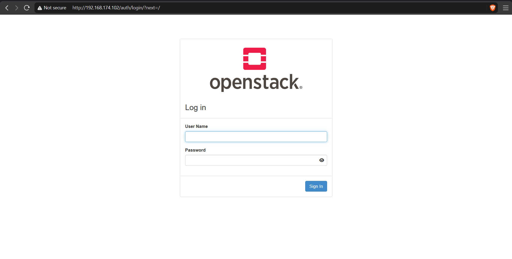
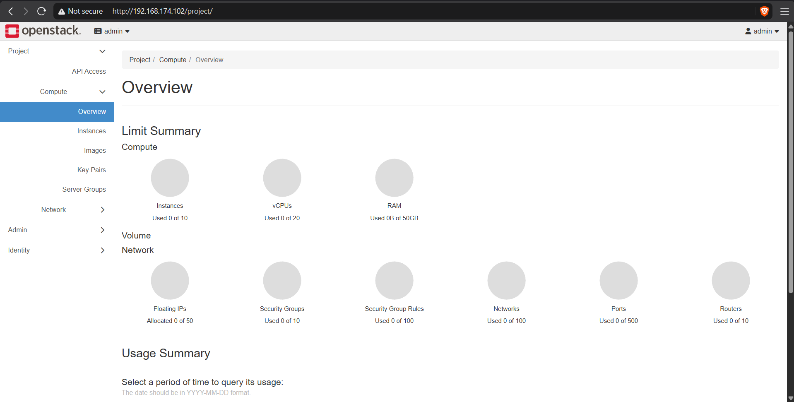

# Mục lục 

- [Mục lục](#mục-lục)
- [Deploy OpenStack Kolla Ansible all-in-one](#deploy-openstack-kolla-ansible-all-in-one)
  - [I. Cấu hình hiện tại](#i-cấu-hình-hiện-tại)
  - [II. Tiền hành cài đặt](#ii-tiền-hành-cài-đặt)
    - [2.0 Chuẩn bị phần cứng cho VM Ubuntu](#20-chuẩn-bị-phần-cứng-cho-vm-ubuntu)
    - [2.1 Chuẩn bị mạng VMWare](#21-chuẩn-bị-mạng-vmware)
    - [2.2 Thêm NIC thứ hai](#22-thêm-nic-thứ-hai)
    - [2.3 Xác định tên NIC trong Ubuntu](#23-xác-định-tên-nic-trong-ubuntu)
    - [2.4 Bật NIC external](#24-bật-nic-external)
    - [2.5 Cài đặt các gói cần thiết](#25-cài-đặt-các-gói-cần-thiết)
    - [2.6 Cấu hình hostname](#26-cấu-hình-hostname)
    - [2.7 Cài Kolla-Ansible 2026.1](#27-cài-kolla-ansible-20261)
    - [2.8 Chuẩn bị inventory và mật khẩu](#28-chuẩn-bị-inventory-và-mật-khẩu)
    - [2.9 Cấu hình `globals.yml` cho host Ubuntu 26.04](#29-cấu-hình-globalsyml-cho-host-ubuntu-2604)
    - [2.10 Bootstrap host](#210-bootstrap-host)
    - [2.11 Chạy prechecks](#211-chạy-prechecks)
    - [2.12 Pull image và deploy](#212-pull-image-và-deploy)
    - [2.13 Cài CLI và xác nhận đăng nhập](#213-cài-cli-và-xác-nhận-đăng-nhập)
    - [2.14 Tạo external network nối ra VMware NAT](#214-tạo-external-network-nối-ra-vmware-nat)
    - [2.15 Tạo private network và router](#215-tạo-private-network-và-router)
    - [2.16 Tạo image, flavor và SSH key để thử](#216-tạo-image-flavor-và-ssh-key-để-thử)
    - [2.17 Tạo security group và VM](#217-tạo-security-group-và-vm)
    - [2.18 Gắn floating IP và thử SSH](#218-gắn-floating-ip-và-thử-ssh)
    - [2.19 Các lệnh dùng ở lần đăng nhập sau](#219-các-lệnh-dùng-ở-lần-đăng-nhập-sau)
- [Tài liệu tham khảo](#tài-liệu-tham-khảo)


# Deploy OpenStack Kolla Ansible all-in-one

## I. Cấu hình hiện tại 

- 1 Node: Ubuntu 26.04.1-liveserver-amd64: 8GB MEM - 40GB DISK 
- NIC: 

  ```bash
  root@control-01:~# ip a
  1: lo: <LOOPBACK,UP,LOWER_UP> mtu 65536 qdisc noqueue state UNKNOWN group default qlen 1000
      link/loopback 00:00:00:00:00:00 brd 00:00:00:00:00:00
      inet 127.0.0.1/8 scope host lo
        valid_lft forever preferred_lft forever
      inet6 ::1/128 scope host noprefixroute
        valid_lft forever preferred_lft forever
  2: ens33: <BROADCAST,MULTICAST,UP,LOWER_UP> mtu 1500 qdisc fq_codel state UP group default qlen 1000
      link/ether 00:0c:29:95:11:aa brd ff:ff:ff:ff:ff:ff
      altname enp2s1
      altname enx000c299511aa
      inet 192.168.174.102/24 brd 192.168.174.255 scope global ens33
        valid_lft forever preferred_lft forever
      inet6 fe80::20c:29ff:fe95:11aa/64 scope link proto kernel_ll
        valid_lft forever preferred_lft forever
  ```

## II. Tiền hành cài đặt 

### 2.0 Chuẩn bị phần cứng cho VM Ubuntu 

Tắt hẳn VM bằng: 

```bash
sudo poweroff
```

Trong VMWare: chọn VM -> Edit virtual machine settings 

NIC -> hãy để 2 network adapters 

Trong Processors → Virtualization engine, bật:

```bash
Virtualize Intel VT-x/EPT or AMD-V/RVI
```

### 2.1 Chuẩn bị mạng VMWare 

Để lab có đường ra Internet và truy cập được từ Windows, tôi dùng VMnet8 NAT cho cả hai NIC, nhưng tách vai trò của chúng trong Ubuntu:

| NIC | Vai trò | Có IP trong Ubuntu? |
|---|---|---|
| Network Adapter 1 | SSH, API, Horizon, tải image | Có |
| Network Adapter 2 | Neutron external, nối vào `br-ex` | Không |

Hai NIC cùng nối vào một mạng VMware vẫn có thể đảm nhiệm hai vai trò trên. NIC thứ hai giúp Neutron quản lý kết nối external mà không đưa NIC đang dùng SSH vào bridge.

### 2.2 Thêm NIC thứ hai 

Trong cấu hình VM:

1. Chọn Network Adapter hiện có.
   
2. Chọn Custom: Specific virtual network → VMnet8.
   
3. Bật Connect at power on.
   
4. Bấm Add → Network Adapter → Finish.
   
5. Với adapter mới, cũng chọn Custom → VMnet8.

6. Bật Connect at power on.

7. Bấm OK.


Đây là thao tác thêm adapter trong VMware Workstation.

Khởi động Ubuntu.


### 2.3 Xác định tên NIC trong Ubuntu 

Chạy: 

```bash
ip -br link
ip -br address
ip route
```

```bash
root@control-01:~# ip -br link
lo               UNKNOWN        00:00:00:00:00:00 <LOOPBACK,UP,LOWER_UP>
ens33            UP             00:0c:29:95:11:aa <BROADCAST,MULTICAST,UP,LOWER_UP>
ens37            DOWN           00:0c:29:95:11:b4 <BROADCAST,MULTICAST>
root@control-01:~# ip -br address
lo               UNKNOWN        127.0.0.1/8 ::1/128
ens33            UP             192.168.174.102/24 fe80::20c:29ff:fe95:11aa/64
ens37            DOWN
root@control-01:~# ip route
default via 192.168.174.2 dev ens33 proto static
192.168.174.0/24 dev ens33 proto kernel scope link src 192.168.174.102
```

Ta sử dụng: 

- `ens33`: NIC quản lý 
- `ens37`: NIC neutron external 

### 2.4 Bật NIC external

```bash
ip link set ens37 up
```

- Kiểm tra: 

```bash
ip -br address
```

```bash
root@control-01:~# ip -br address
lo               UNKNOWN        127.0.0.1/8 ::1/128
ens33            UP             192.168.174.102/24 fe80::20c:29ff:fe95:11aa/64
ens37            UP             fe80::20c:29ff:fe95:11b4/64
```

### 2.5 Cài đặt các gói cần thiết 

```bash
apt update 
```

```bash
apt -o DPkg::Lock::Timeout=600 install -y \
  git curl ca-certificates \
  build-essential pkg-config \
  python3-dev python3-venv python3-pip \
  python3-apt python3-dbus \
  libffi-dev libssl-dev \
  libdbus-1-dev libdbus-glib-1-dev \
  locales chrony openssh-server \
  open-vm-tools
```

### 2.6 Cấu hình hostname 

```bash
vi /etc/hosts
```

Đảm bảo có: 

```bash
127.0.0.1 localhost
192.168.174.102 control-01
```

Nếu tên `control-01` đang được ánh xạ tới `127.0.1.1`, bỏ tên đó khỏi dòng loopback.

- Kiểm tra: 

```bash
root@control-01:~# getent ahostsv4 control-01
192.168.174.102 STREAM control-01
192.168.174.102 DGRAM
192.168.174.102 RAW
```

Thiết lập UTF-8: 

```bash
update-locale LANG=C.UTF-8 LC_ALL=C.UTF-8

export LANG=C.UTF-8
export LC_ALL=C.UTF-8

locale charmap
```

Bật forwarding: 

```bash
cat > /etc/sysctl.d/99-kolla-lab.conf <<'EOF'
net.ipv4.ip_forward = 1
EOF

sysctl --system
```

Bật đồng bộ thời gian:

```bash
systemctl enable --now chrony
chronyc tracking
```

### 2.7 Cài Kolla-Ansible 2026.1

Tạo môi trường python cho công cụ triển khai: 

```bash
python3 -m venv /opt/kolla-venv-2026.1

source /opt/kolla-venv-2026.1/bin/activate

python -m pip install --upgrade pip
```

Cài Kolla-ansible: 

```bash
python -m pip install \
  'ansible-core>=2.20,<2.21' \
  'git+https://opendev.org/openstack/kolla-ansible@stable/2026.1'
```

Kiểm tra: 

```bash
which kolla-ansible
ansible --version
```

```bash
(kolla-venv-2026.1) root@control-01:~# which kolla-ansible
/opt/kolla-venv-2026.1/bin/kolla-ansible
(kolla-venv-2026.1) root@control-01:~# ansible --version
ansible [core 2.20.11]
  config file = None
  configured module search path = ['/root/.ansible/plugins/modules', '/usr/share/ansible/plugins/modules']
  ansible python module location = /opt/kolla-venv-2026.1/lib/python3.14/site-packages/ansible
  ansible collection location = /root/.ansible/collections:/usr/share/ansible/collections
  executable location = /opt/kolla-venv-2026.1/bin/ansible
  python version = 3.14.4 (main, Aug 20 2026, 10:41:58) [GCC 15.2.0] (/opt/kolla-venv-2026.1/bin/python)
  jinja version = 3.1.6
  pyyaml version = 6.0.4 (with libyaml v0.2.6)
```

### 2.8 Chuẩn bị inventory và mật khẩu 

```bash
mkdir -p /etc/kolla
mkdir -p /root/kolla-2026.1
```

Chép file mẫu: 

```bash
cp \
  /opt/kolla-venv-2026.1/share/kolla-ansible/etc_examples/kolla/globals.yml \
  /etc/kolla/globals.yml

cp \
  /opt/kolla-venv-2026.1/share/kolla-ansible/etc_examples/kolla/passwords.yml \
  /etc/kolla/passwords.yml
```

Chép inventory: 

```bash
cp \
  /opt/kolla-venv-2026.1/share/kolla-ansible/ansible/inventory/all-in-one \
  /root/kolla-2026.1/all-in-one

cd /root/kolla-2026.1
```

Cài Ansible collections:

```bash
kolla-ansible install-deps
```

Tạo mật khẩu: 

```bash
kolla-genpwd
chmod 600 /etc/kolla/passwords.yml
```

Giữ lại file `passwords.yml` này trong suốt vòng đời cài đặt, không thay bằng file mẫu sau khi triển khai.

### 2.9 Cấu hình `globals.yml` cho host Ubuntu 26.04

```bash
vi /etc/kolla/globals.yml
```

Thay nội dung bằng cấu hình lab: 

```yaml
---
# OpenStack và image container.
openstack_release: "2026.1"
kolla_base_distro: "ubuntu"
kolla_base_distro_version: "noble"
kolla_container_engine: "docker"

# Thử nghiệm trên host Ubuntu 26.04:
# chỉ bỏ bước kiểm tra danh sách OS được hỗ trợ.
prechecks_enable_host_os_checks: false

# Mạng quản lý và API.
network_interface: "ens33"
api_interface: "ens33"
tunnel_interface: "ens33"

# Dùng trực tiếp IP host, không cấp VIP riêng.
kolla_internal_vip_address: "192.168.174.102"

enable_haproxy: false
enable_keepalived: false
enable_proxysql: false

# Mạng Neutron.
neutron_plugin_agent: "openvswitch"
neutron_external_interface: "ens37"

# Virtualenv dành cho module chạy trên host.
# Bootstrap sẽ tạo môi trường này.
virtualenv: "/opt/kolla-target-2026.1"
virtualenv_site_packages: true

# Dịch vụ cho lab.
enable_horizon: true
enable_cinder: false
enable_heat: false

# Đổi thành "kvm" nếu KVM đã khả dụng.
nova_compute_virt_type: "kvm"
```

### 2.10 Bootstrap host

```bash
cd /root/kolla-2026.1

kolla-ansible bootstrap-servers -i ./all-in-one
```

Bước này cài và cấu hình Docker, các phụ thuộc host và virtualenv dành cho module Ansible 

Sau khi thành công, kiểm tra:

```bash
systemctl is-active docker
docker version
```

```bash
(kolla-venv-2026.1) root@control-01:~/kolla-2026.1# systemctl is-active docker
docker version
active
Client: Docker Engine - Community
 Version:           29.10.1
 API version:       1.57
 Go version:        go1.27.4
 Git commit:        c48360f
 Built:             Tue Nov 24 19:44:28 2026
 OS/Arch:           linux/amd64
 Context:           default

Server: Docker Engine - Community
 Engine:
  Version:          29.10.1
  API version:      1.57 (minimum version 1.40)
  Go version:       go1.27.4
  Git commit:       54cd494
  Built:            Tue Nov 24 19:44:30 2026
  OS/Arch:          linux/amd64
  Experimental:     false
 containerd:
  Version:          v2.4.2
  GitCommit:        b7a25261e029d68978bbf290df0a62fc819b3c51
 runc:
  Version:          1.5.3
  GitCommit:        v1.5.3-0-g46365c62
 docker-init:
  Version:          0.19.0
  GitCommit:        de40ad0
(kolla-venv-2026.1) root@control-01:~/kolla-2026.1#
```

Kiểm tra module trong môi trường target: 

```bash
/opt/kolla-target-2026.1/bin/python -c \
  "import docker, dbus; print('Docker SDK và D-Bus OK')"
```

### 2.11 Chạy prechecks

```bash
kolla-ansible prechecks \
  -i ./all-in-one \
  --use-test-images
```

### 2.12 Pull image và deploy

- Pull image: 

```bash
kolla-ansible pull -i ./all-in-one 
```

- Deploy: 

```bash
kolla-ansible deploy -i ./all-in-one
```

- Khi deploy thành công:

```bash
kolla-ansible post-deploy -i ./all-in-one
```

Kiểm tra container:

```bash
docker ps -a --format 'table {{.Names}}\t{{.Status}}'
```

### 2.13 Cài CLI và xác nhận đăng nhập 

Vẫn trong virtualenv `/opt/kolla-venv-2026.1`: 

```bash
python -m pip install python-openstackclient \
  -c https://releases.openstack.org/constraints/upper/2026.1
```

Nạp cấu hình: 

```bash
export OS_CLIENT_CONFIG_FILE=/etc/kolla/clouds.yaml
export OS_CLOUD=kolla-admin
```

Kiểm tra token, chỉ in thời gian hết hạn:

```bash
openstack token issue -f value -c expires
```

Kiểm tra: 

```bash
openstack compute service list
openstack hypervisor list
openstack network agent list
```

```bash
(kolla-venv-2026.1) root@control-01:~/kolla-2026.1# openstack token issue -f value -c expires
2026-11-27T04:09:23+0000
(kolla-venv-2026.1) root@control-01:~/kolla-2026.1# openstack compute service list
+--------------------------------------+----------------+------------+----------+---------+-------+----------------------------+
| ID                                   | Binary         | Host       | Zone     | Status  | State | Updated At                 |
+--------------------------------------+----------------+------------+----------+---------+-------+----------------------------+
| 52db385e-d839-4e2e-8340-5e18bca06cda | nova-scheduler | control-01 | internal | enabled | up    | 2026-11-26T04:09:30.000000 |
| 099b2628-4933-42fa-8aa8-5c4167bb3aad | nova-conductor | control-01 | internal | enabled | up    | 2026-11-26T04:09:31.000000 |
| a74f32be-75c2-47a1-b00f-c82a50676913 | nova-compute   | control-01 | nova     | enabled | up    | 2026-11-26T04:09:32.000000 |
+--------------------------------------+----------------+------------+----------+---------+-------+----------------------------+
(kolla-venv-2026.1) root@control-01:~/kolla-2026.1# openstack hypervisor list
+--------------------------------------+---------------------+-----------------+-----------------+-------+
| ID                                   | Hypervisor Hostname | Hypervisor Type | Host IP         | State |
+--------------------------------------+---------------------+-----------------+-----------------+-------+
| ef241f8b-b4cb-53ea-815b-9409bcab676d | control-01          | QEMU            | 192.168.174.102 | up    |
+--------------------------------------+---------------------+-----------------+-----------------+-------+
(kolla-venv-2026.1) root@control-01:~/kolla-2026.1# openstack network agent list
+--------------------------------------+--------------------+------------+-------------------+-------+-------+---------------------------+
| ID                                   | Agent Type         | Host       | Availability Zone | Alive | State | Binary                    |
+--------------------------------------+--------------------+------------+-------------------+-------+-------+---------------------------+
| 794fd068-610b-4cf3-bbf1-c01e0be9a654 | L3 agent           | control-01 | nova              | :-)   | UP    | neutron-l3-agent          |
| 850e5ee4-9c53-4d95-872e-931a33fb2e98 | Metadata agent     | control-01 | None              | :-)   | UP    | neutron-metadata-agent    |
| 922827c3-5fda-4856-88e0-0372579d156f | DHCP agent         | control-01 | nova              | :-)   | UP    | neutron-dhcp-agent        |
| ebcdd208-58e8-4106-a981-21121acd62e7 | Open vSwitch agent | control-01 | None              | :-)   | UP    | neutron-openvswitch-agent |
+--------------------------------------+--------------------+------------+-------------------+-------+-------+---------------------------+
```

Truy cập Horizon từ Windows: 



Đăng nhập bằng tk `admin` với mk lấy bằng lệnh sau: 

```bash
awk '/^keystone_admin_password:/ {print $2}' /etc/kolla/passwords.yml
```



### 2.14 Tạo external network nối ra VMware NAT 

Tạo mạng external dạng flat: 

```bash
openstack network create public --external --provider-network-type flat --provider-physical-network physnet1
```

Tạo subnet external: 

```bash
openstack subnet create public-subnet --network public --subnet-range 192.168.174.0/24 --gateway 192.168.174.2 --allocation-pool start=192.168.174.200,end=192.168.174.240 --no-dhcp
```

### 2.15 Tạo private network và router 

Tạo mạng private: 

```bash
openstack network create private
```

Tạo subnet private: 

```bash
openstack subnet create private-subnet --network private --subnet-range 10.10.10.0/24 --gateway 10.10.10.1 --dns-nameserver 1.1.1.1 --dns-nameserver 8.8.8.8
```

Tạo router: 

```bash
openstack router create lab-router 
openstack router set lab-router --external-gateway public 
openstack router add subnet lab-router private-subnet
```

Luồng dự kiến khi guest ra Internet: 

> Guest → router Neutron → NIC external → VMnet8 → VMware NAT → Internet.

### 2.16 Tạo image, flavor và SSH key để thử 

Dùng CirrOS nhỏ để kiểm tra compute/network trước. Đây là image cloud, khác với ISO live-server dùng cài host Ubuntu. Image 0.6.3 có trong kho chính thức của CirrOS.

```bash
mkdir -p /root/images
```

```bash
curl -fL \
  https://download.cirros-cloud.net/0.6.3/cirros-0.6.3-x86_64-disk.img \
  -o /root/images/cirros-0.6.3-x86_64-disk.img
```

Upload: 

```bash
openstack image create cirros \
  --file /root/images/cirros-0.6.3-x86_64-disk.img \
  --disk-format qcow2 \
  --container-format bare
```

Tạo flavor: 

```bash
openstack flavor create lab.small --vcpus 1 --ram 512 --disk 1
```

Tạo SSH key: 

```bash
mkdir -p /root/.ssh
chmod 700 /root/.ssh

ssh-keygen -t ed25519 \
  -f /root/.ssh/kolla-lab \
  -N ''
```

Đăng ký public key:

```bash
openstack keypair create lab-key \
  --public-key /root/.ssh/kolla-lab.pub
```

### 2.17 Tạo security group và VM 

```bash
openstack security group create lab-sg
```

Cho phép ping và ssh: 

```bash
openstack security group rule create lab-sg --ingress --protocol icmp 
```

```bash
openstack security group rule create lab-sg --ingress --protocol tcp --dst-port 22
```

Tạo VM: 

```bash
openstack server create test-vm \
  --image cirros \
  --flavor lab.small \
  --network private \
  --security-group lab-sg \
  --key-name lab-key
```

**NOTE:** Sau khi KVM đã hoạt động, tài khoản `nova` thiếu quyền truy cập `/dev/kvm`. Thiết bị thuộc nhóm 992, còn nova không thuộc nhóm đó. Vì libvirt chạy QEMU bằng tài khoản nova, VM không khởi tạo được.

### 2.18 Gắn floating IP và thử SSH 

Tạo floating IP: 

```bash
openstack floating ip create public -f value -c floating_ip_address
```

```bash
(kolla-venv-2026.1) root@control-01:~/kolla-2026.1# openstack floating ip create public -f value -c floating_ip_address
192.168.174.239
```

Gắn vào VM: 

```bash
openstack server add floating ip test-vm 192.168.174.239
```

Test ping từ ubuntu host chạy kolla: 

```bash
ping 192.168.174.239
```

```bash
(kolla-venv-2026.1) root@control-01:~/kolla-2026.1# ping 192.168.174.239
PING 192.168.174.239 (192.168.174.239) 56(84) bytes of data.
64 bytes from 192.168.174.239: icmp_seq=1 ttl=63 time=1.11 ms
64 bytes from 192.168.174.239: icmp_seq=2 ttl=63 time=1.63 ms
64 bytes from 192.168.174.239: icmp_seq=3 ttl=63 time=0.648 ms
64 bytes from 192.168.174.239: icmp_seq=4 ttl=63 time=0.753 ms
64 bytes from 192.168.174.239: icmp_seq=5 ttl=63 time=0.446 ms
^C
--- 192.168.174.239 ping statistics ---
5 packets transmitted, 5 received, 0% packet loss, time 4012ms
rtt min/avg/max/mdev = 0.446/0.917/1.627/0.415 ms
```

SSH: 

```bash
ssh -i /root/.ssh/kolla-lab cirros@192.168.174.239
```

```bash
(kolla-venv-2026.1) root@control-01:~/kolla-2026.1# ssh -i /root/.ssh/kolla-lab cirros@192.168.174.239
The authenticity of host '192.168.174.239 (192.168.174.239)' can't be established.
ED25519 key fingerprint is: SHA256:Z34OVnkLcE1/rTLR98IsDgZqNGR3b8nlsHs10T+ka0s
This key is not known by any other names.
Are you sure you want to continue connecting (yes/no/[fingerprint])? yes
Warning: Permanently added '192.168.174.239' (ED25519) to the list of known hosts.
** WARNING: connection is not using a post-quantum key exchange algorithm.
** This session may be vulnerable to "store now, decrypt later" attacks.
** The server may need to be upgraded. See https://openssh.com/pq.html
$
```

Bên trong CirrOS, kiểm tra: 

```bash
ip a
ip route 
ping -c 3 1.1.1.1
```

```bash
$ ip a
1: lo: <LOOPBACK,UP,LOWER_UP> mtu 65536 qdisc noqueue qlen 1000
    link/loopback 00:00:00:00:00:00 brd 00:00:00:00:00:00
    inet 127.0.0.1/8 scope host lo
       valid_lft forever preferred_lft forever
    inet6 ::1/128 scope host
       valid_lft forever preferred_lft forever
2: eth0: <BROADCAST,MULTICAST,UP,LOWER_UP> mtu 1450 qdisc pfifo_fast qlen 1000
    link/ether fa:16:3e:b1:9a:0a brd ff:ff:ff:ff:ff:ff
    inet 10.10.10.161/24 brd 10.10.10.255 scope global dynamic noprefixroute eth0
       valid_lft 85157sec preferred_lft 74357sec
    inet6 fe80::f816:3eff:feb1:9a0a/64 scope link
       valid_lft forever preferred_lft forever
$ ip route
default via 10.10.10.1 dev eth0  src 10.10.10.161  metric 1002
10.10.10.0/24 dev eth0 scope link  src 10.10.10.161  metric 1002
169.254.169.254 via 10.10.10.2 dev eth0  src 10.10.10.161  metric 1002
$ ping -c 3 1.1.1.1
PING 1.1.1.1 (1.1.1.1) 56(84) bytes of data.
64 bytes from 1.1.1.1: icmp_seq=1 ttl=127 time=53.3 ms
64 bytes from 1.1.1.1: icmp_seq=2 ttl=127 time=47.1 ms
64 bytes from 1.1.1.1: icmp_seq=3 ttl=127 time=47.5 ms

--- 1.1.1.1 ping statistics ---
3 packets transmitted, 3 received, 0% packet loss, time 2004ms
rtt min/avg/max/mdev = 47.111/49.329/53.337/2.839 ms
```

### 2.19 Các lệnh dùng ở lần đăng nhập sau 

Khi SSH lại vào Ubuntu: 

```bash
sudo -i
export LANG=C.UTF-8
export LC_ALL=C.UTF-8
source /opt/kolla-venv-2026.1/bin/activate
export OS_CLIENT_CONFIG_FILE=/etc/kolla/clouds.yaml
export OS_CLOUD=kolla-admin
cd /root/kolla-2026.1
```

Sau đó kiểm tra: 

```bash
openstack server list
```

# Tài liệu tham khảo 

https://docs.openstack.org/kolla-ansible/latest/user/quickstart.html

https://superuser.openinfra.org/articles/kolla-ansible-openstack-installation-ubuntu-24-04/