# Mục lục 

- [Mục lục](#mục-lục)
- [Sử dụng SonarQube](#sử-dụng-sonarqube)
  - [I. Chuẩn bị](#i-chuẩn-bị)
  - [II. Cài đặt SonarQube](#ii-cài-đặt-sonarqube)
  - [III. Sử dụng user/group trong Sonarqube](#iii-sử-dụng-usergroup-trong-sonarqube)
  - [IV. Quét dự án trên SonarQube (code static analysis)](#iv-quét-dự-án-trên-sonarqube-code-static-analysis)
  - [V. Dùng SonarQube dự án k8s-monitoring-tool](#v-dùng-sonarqube-dự-án-k8s-monitoring-tool)
  - [VI. Các thành phần khác trong SonarQube](#vi-các-thành-phần-khác-trong-sonarqube)
    - [6.0 Rules](#60-rules)
    - [6.1 Quality Profile](#61-quality-profile)
    - [6.2 Quality Gate](#62-quality-gate)


# Sử dụng SonarQube 

## I. Chuẩn bị 

Chuẩn bị ubuntu server đã cài đặt Docker

```bash
sudo apt update
sudo apt install -y ca-certificates curl

sudo install -m 0755 -d /etc/apt/keyrings

sudo curl -fsSL \
  https://download.docker.com/linux/ubuntu/gpg \
  -o /etc/apt/keyrings/docker.asc

sudo chmod a+r /etc/apt/keyrings/docker.asc
```

```bash
sudo tee /etc/apt/sources.list.d/docker.sources <<EOF
Types: deb
URIs: https://download.docker.com/linux/ubuntu
Suites: jammy
Components: stable
Architectures: $(dpkg --print-architecture)
Signed-By: /etc/apt/keyrings/docker.asc
EOF
```

```bash
sudo apt update
sudo apt install -y \
  docker-ce \
  docker-ce-cli \
  containerd.io \
  docker-buildx-plugin \
  docker-compose-plugin
```

```bash
sudo systemctl enable --now docker
```

## II. Cài đặt SonarQube 

Ta sẽ sử dụng docker để chạy SonarQube server: 

```bash
docker run --name sonarqube -dp 80:9000 sonarqube
```

Sau khi chạy xong truy cập vào IP của server sẽ được kết quả như dưới đây tài khoản mặc định sẽ là `admin/admin`

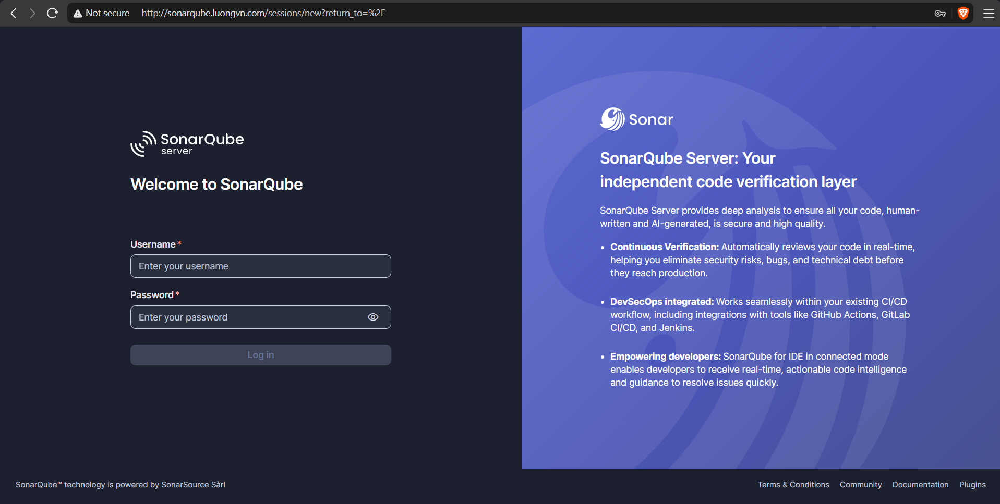

## III. Sử dụng user/group trong Sonarqube

Thiết lập thành công vào Sonarqube đầu tiên bạn chọn `Administration`: 

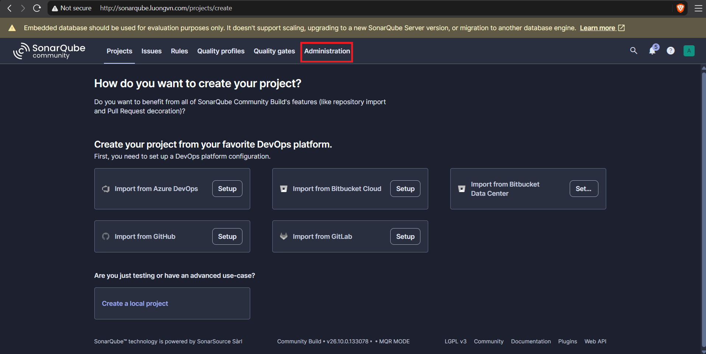

Chọn vào `Security -> Users` ta sẽ thấy đang có 1 user admin:

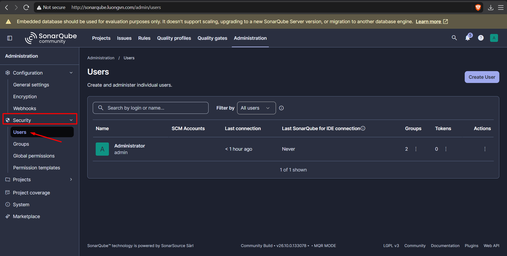

Chọn vào `Security -> Groups` ta sẽ thấy 2 group cơ bản như dưới đây: 

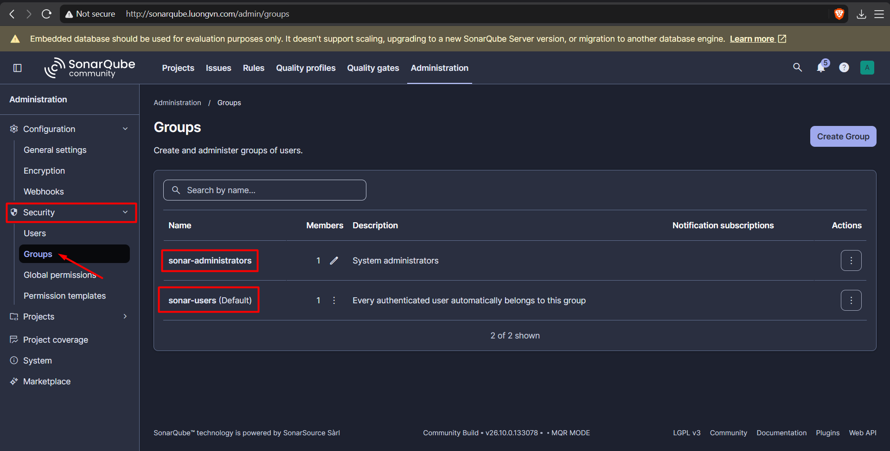

Tiếp đến, ta tạo người dùng mới: Nhấn chọn `Create User`: 

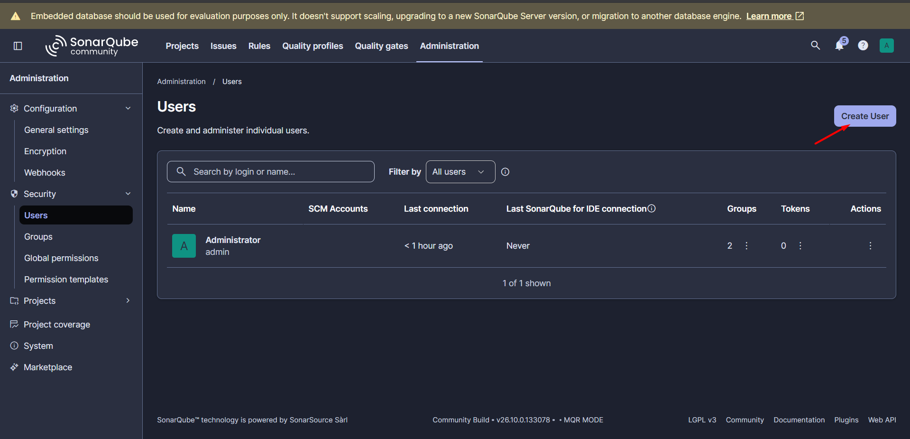

Điền các thông tin cơ bản của user: 

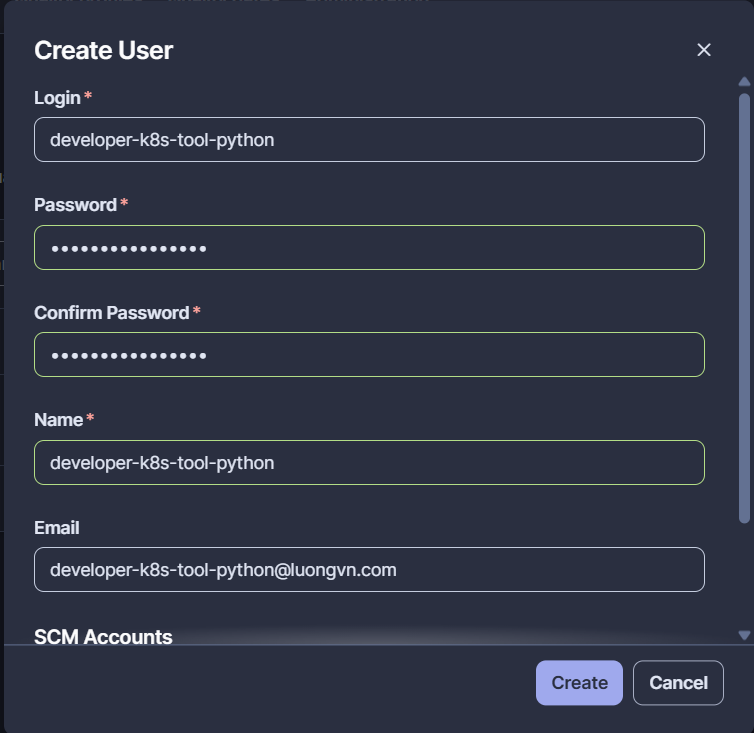

Tạo thành công ta qua phần groups: 

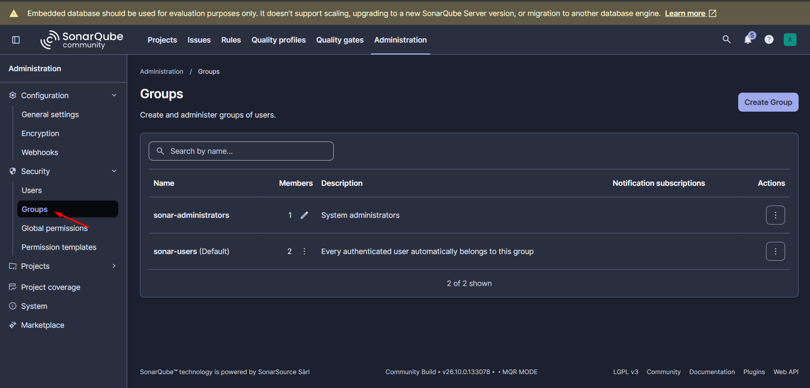

Ta sẽ tạo group chọn `Create group`: 

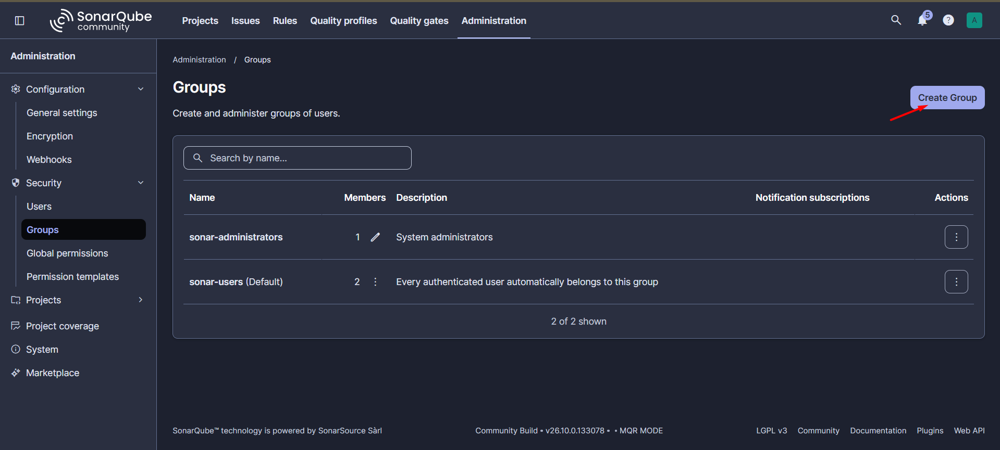

Điền các thông tin cho group: 

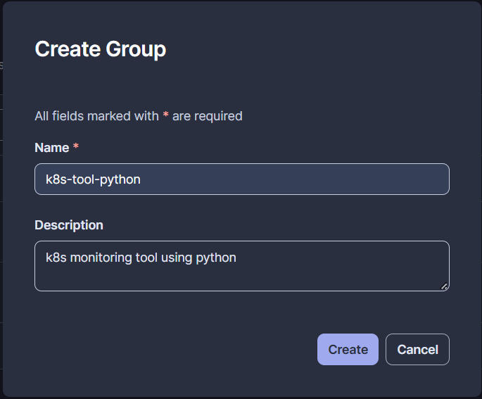

Tiếp theo ta nhấn chọn vào Member để thêm user vào group hiện tạo là 0: 

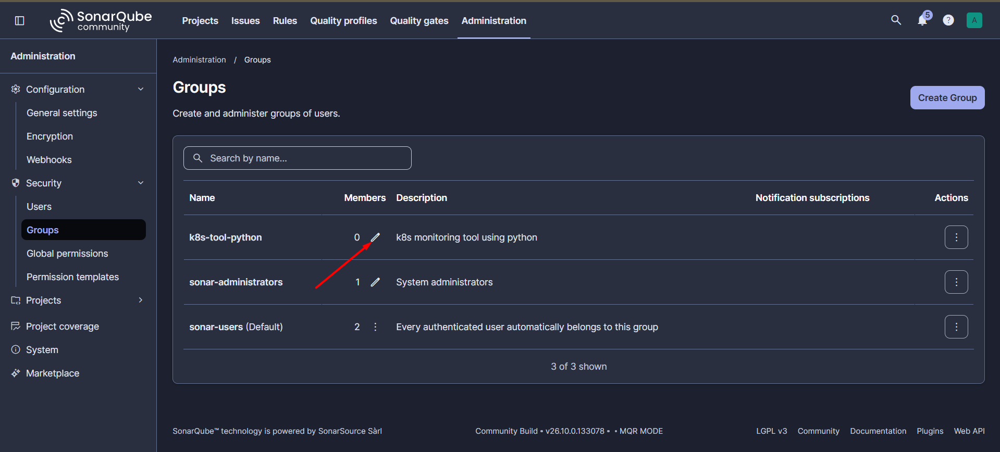

Nhấn chọn user ta vừa tạo ở trên vào group: 

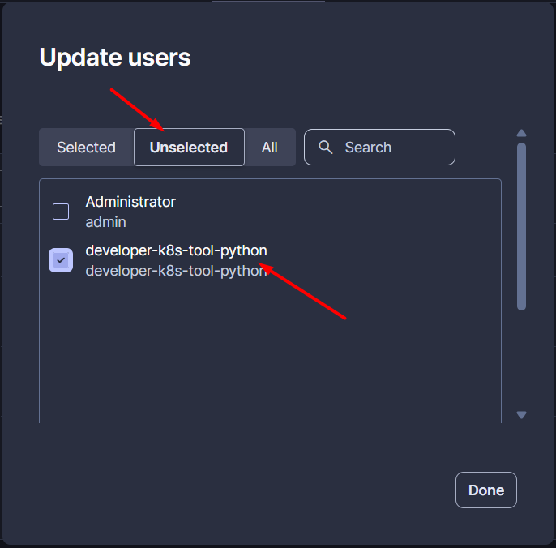

Tiếp theo chọn `Security -> Global Permissions` và bỏ tích chọn group `sonar-users` được quyền tạo project

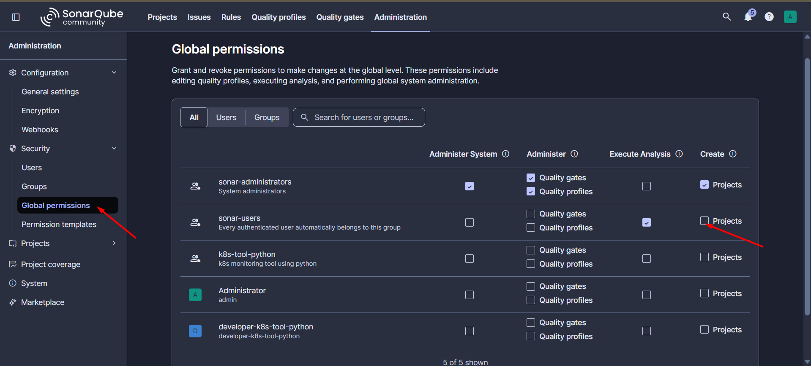

Ta sẽ tạo thêm 1 user nữa là `sonar-scanner` đóng vai trò quét code: 

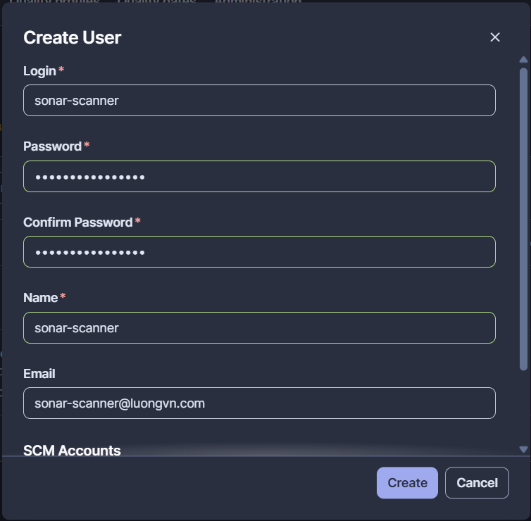

Và thêm user sonar vào group admin 

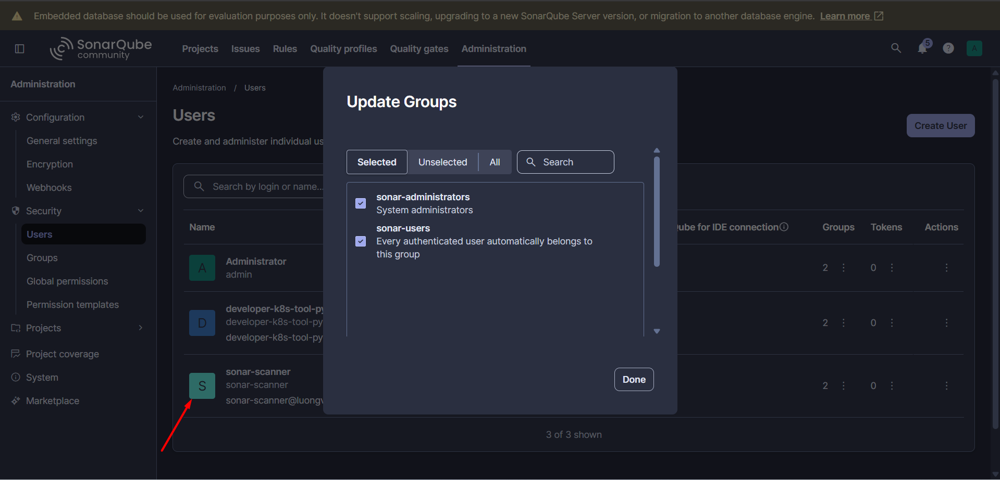

## IV. Quét dự án trên SonarQube (code static analysis) 

Chọn `Projects` và nhấn `Create Project`: 

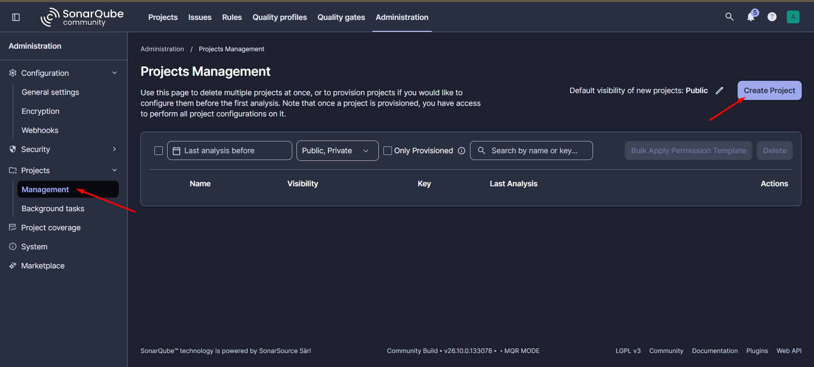

Điền các thông tin dự án: 

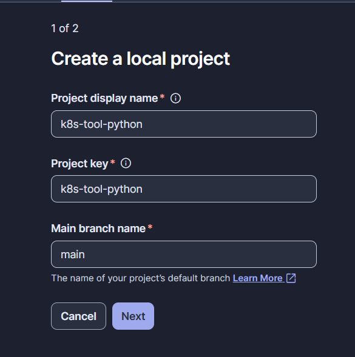

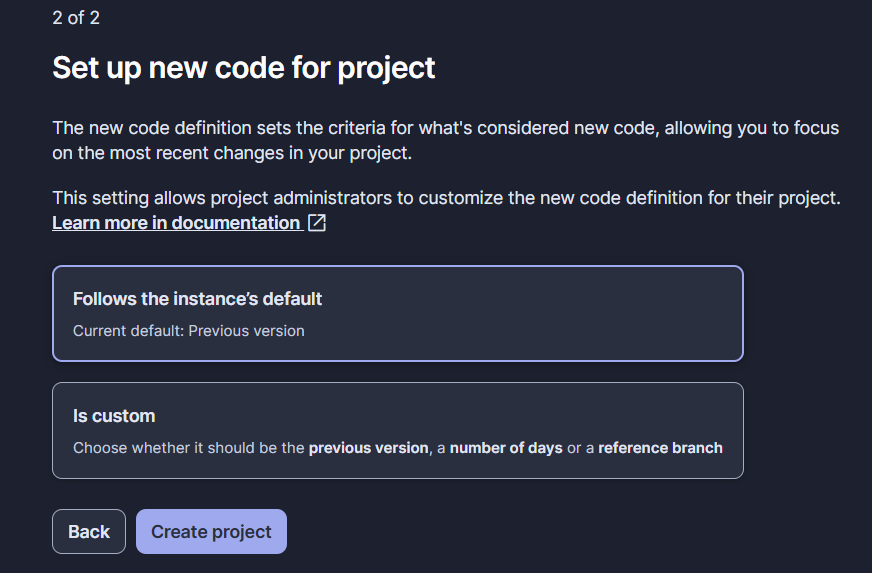

Tạo thành công ta nhấn chọn vào `Setting -> Edit permissions`: 

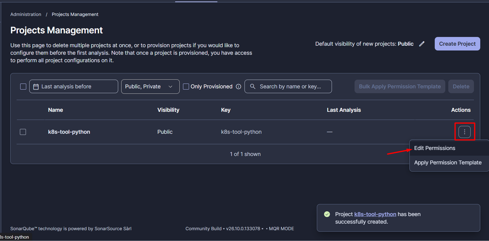

Tiến hành tích chọn như dưới đây để bảo mật dự án chọn đúng group và các quyền (vì mặc định các user tạo trong group Sonar user nên chúng ta phải bỏ tích chọn nếu không các user khác đều có thể xem được project)

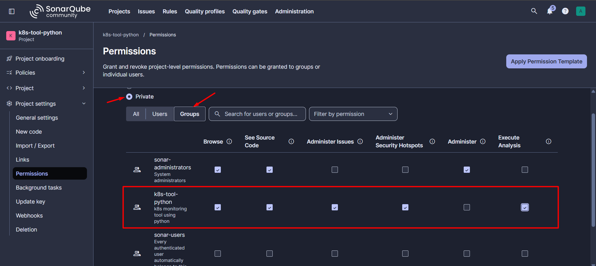

Các tích chọn cụ thể như sau:

- `Browse (trình duyệt)`: Quyền này cho phép người dùng xem thông tin tổng quan về dự án và các báo cáo kiểm tra chất lượng mã nguồn. Người dùng có quyền này có thể truy cập thông tin cơ bản như kiểm tra chất lượng mã nguồn, số lượng lỗi và cảnh báo, và các chi tiết dự án 
- `See Source Code`: Quyền này cho phép người dùng xem source code của dự án. Điều này hữu ích cho việc xem mã nguồn để hiểu và khắc phục các vấn đề liên quan đến chất lượng mã nguồn.
- `Administer Issues (Quản lý vấn đề)`: Quyền này cho phép người dùng quản lý các vấn đề (issues) được tạo ra bởi SonarQube. Người dùng có quyền này có thể thực hiện các hoạt động như gán vấn đề, đánh giá mức độ quan trọng của vấn đề và thay đổi trạng thái của vấn đề (ví dụ: xác nhận, từ chối).
- `Administer Security Hotspots (Quản lý Security Hotspots)`: Quyền này liên quan đến việc quản lý các lỗ hổng bảo mật (security hotspots) trong mã nguồn. Người dùng có quyền này có thể quản lý và gán các security hotspot và thực hiện các hoạt động liên quan đến việc giải quyết các vấn đề bảo mật.
- `Administer (Quản lý)`: Quyền này cung cấp quyền quản lý cao nhất cho dự án trên SonarQube. Người dùng có quyền này có thể quản lý toàn bộ dự án, bao gồm quyền thay đổi cấu hình, thêm hoặc xóa dự án, quản lý người dùng và quản lý quyền truy cập dự án.
- `Execute Analysis (Thực hiện phân tích)`: Quyền này cho phép người dùng thực hiện phân tích chất lượng mã nguồn. Người dùng với quyền này có thể chạy quy trình kiểm tra chất lượng mã nguồn trên dự án. Điều này quan trọng để cập nhật thông tin kiểm tra chất lượng mã nguồn và báo cáo kết quả.

**Tạo TOKEN:** Tiến hành đăng nhập vào tài khoản `sonar-scanner` và chọn vào `My Account`: 


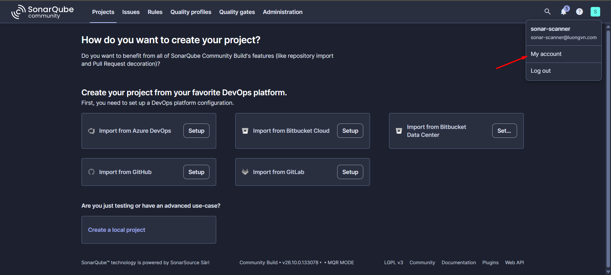

Chọn vào `Security` và tiến hành tạo Token như dưới đây (`Name` và `Expies` in tùy ý nhưng `Type` là `Global Analysis Token`)

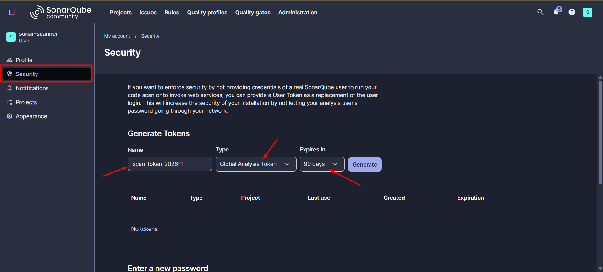

Nhấn tạo thành công và copy Token và lưu lại vì nó sẽ không hiển thị lại đâu: `sqa_e2da4c84046669c3cf36740d504ad326c17f0aa5`

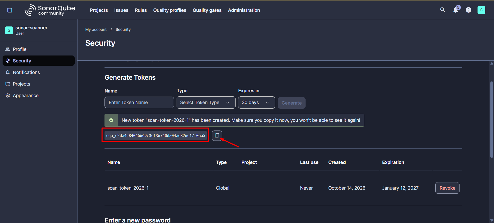

## V. Dùng SonarQube dự án k8s-monitoring-tool 

Truy cập vào server và tiến hành clone dự án về: 

```bash
git clone https://github.com/Bimmie226/kubernetes-monitoring-tool.git
```

Tiếp theo di chuyển vào bên trong dự án: 

```bash
cd kubernetes-monitoring-tool/
```

Tiếp theo chúng ta sẽ chạy lệnh để quét dự án bằng sonar-scanner-cli, thay vì phải cài đặt các công cụ thì ta chỉ cần cài đặt docker và sẽ chạy các công cụ test, check sau khi chạy xong thì xóa container luôn(chỉnh những thông tin: `SONAR_PROJECT_KEY`, `SONAR_PROJECT_NAME`, `SONAR_HOST_URL`, `SONAR_TOKEN`, `SONAR_VERSION`)

```bash
docker run -v $(pwd):/project --workdir="/project" sonarsource/sonar-scanner-cli -Dsonar.host.url="http://192.168.174.104" -Dsonar.login="sqa_e2da4c84046669c3cf36740d504ad326c17f0aa5" -Dsonar.projectKey="k8s-monitoring-tool" -Dsonar.projectName="k8s-monitoring-tool" -Dsonar.sources="." -Dsonar.projectVersion="v1.0.0"
```

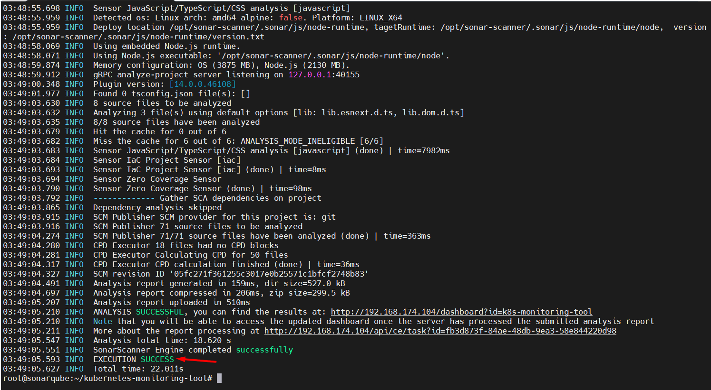

Sau đó ta được kết quả trên Sonarqube server:

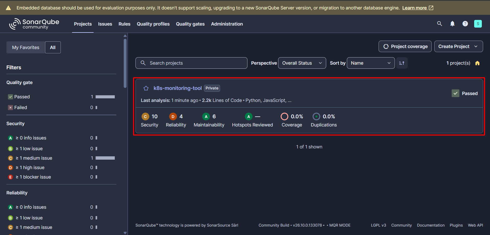

## VI. Các thành phần khác trong SonarQube 

### 6.0 Rules

Rule là một quy tắc cụ thể để SonarQube phát hiện vấn đề trong code. Một Rule có thể phát hiện: "không được hard-code credential trong source code" hoặc cũng có thể cảnh báo không nên so sánh boolean với `True` một cách dư thừa 

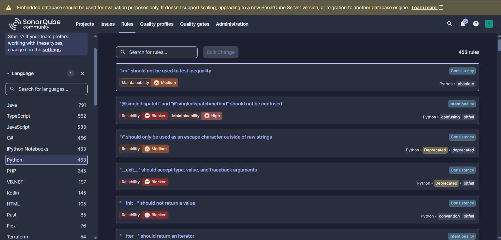

Ta có thể xem cụ thể 1 rule: 

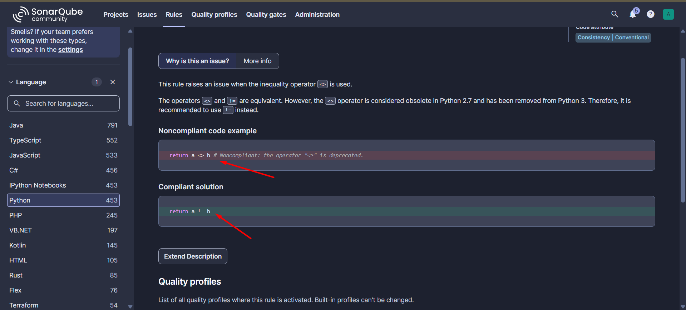

### 6.1 Quality Profile 

Quality Profile trả lời cho câu hỏi: "Áp dụng những RULE nào ?" 

Quality Profile là một tập hợp các rules được kích hoạt cho một ngôn ngữ. SonarQube dùng profile này để quyết định rules nào sẽ được dùng khi phân tích code 

### 6.2 Quality Gate 

Quality Gate là một tập các điều kiện dùng để đánh giá kết quả phân tích của 1 project 

Đây là thông số mặc định: 

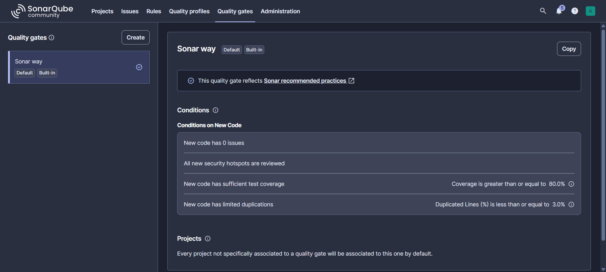

Để tạo ra cơ chế mới ta nhấn vào `Copy`: 

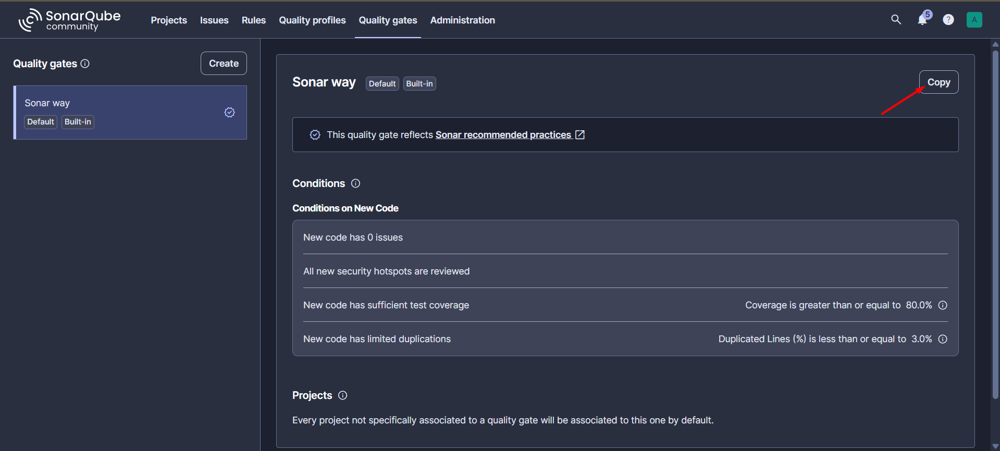

Nhập tên quality gate mới: 

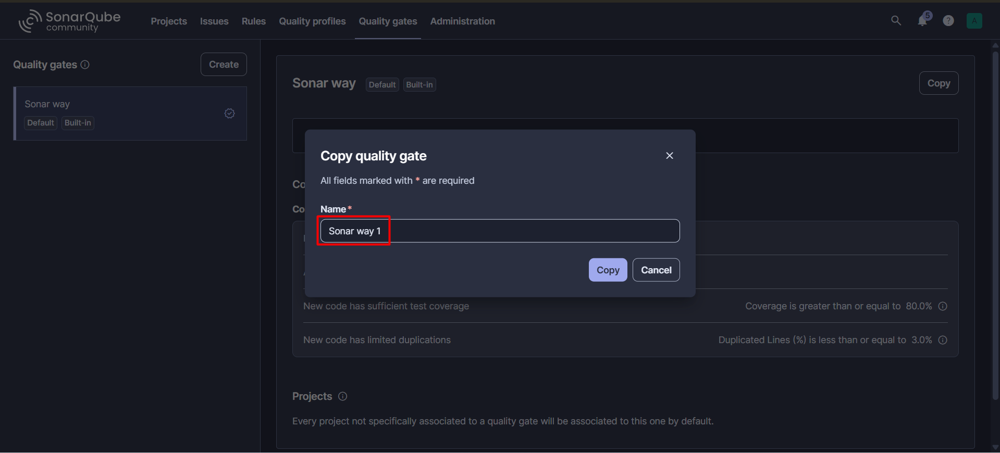

Ta có thể tùy chỉnh để kiểm tra chất lượng code khắt khe hơn như dưới đây như Coverage 90% và Duplicated Lines lớn hơn 1%

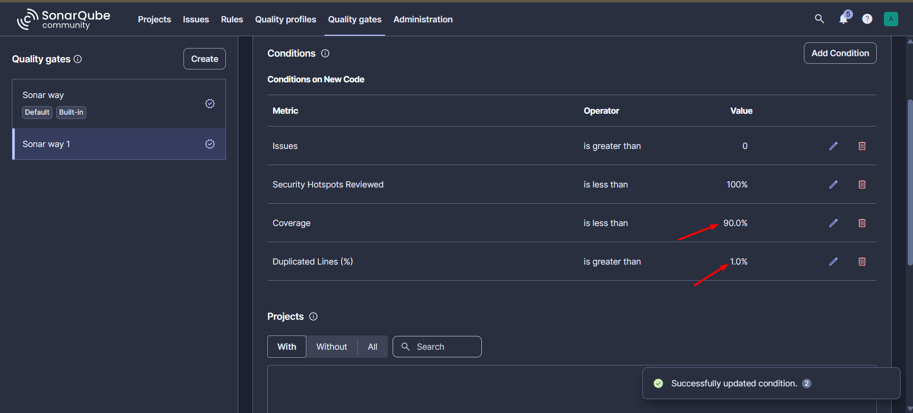

Ta sẽ tiến hành sửa thêm một số cơ chế nữa như sau chọn vào `Add Condition`

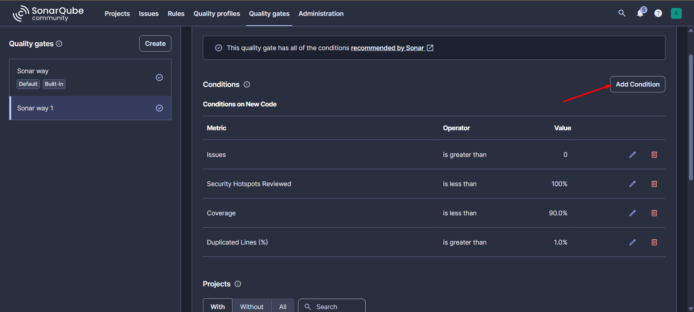

Giới hạn số `duplicate block`: 

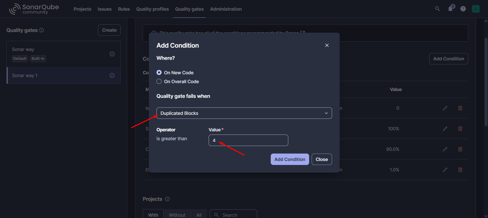

Thêm `Line Coverage`: 

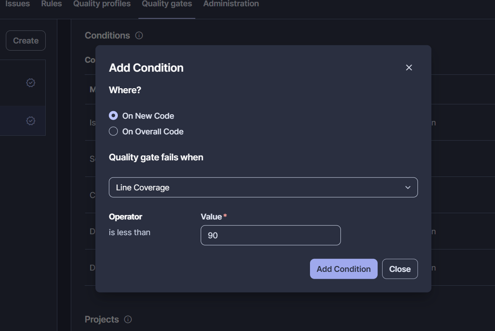

Áp dụng vào dự án cụ thể dưới đây: 

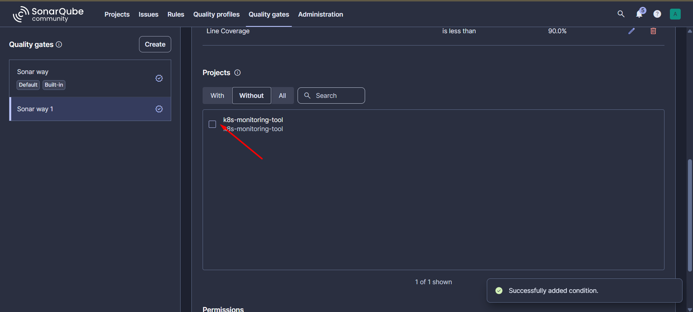