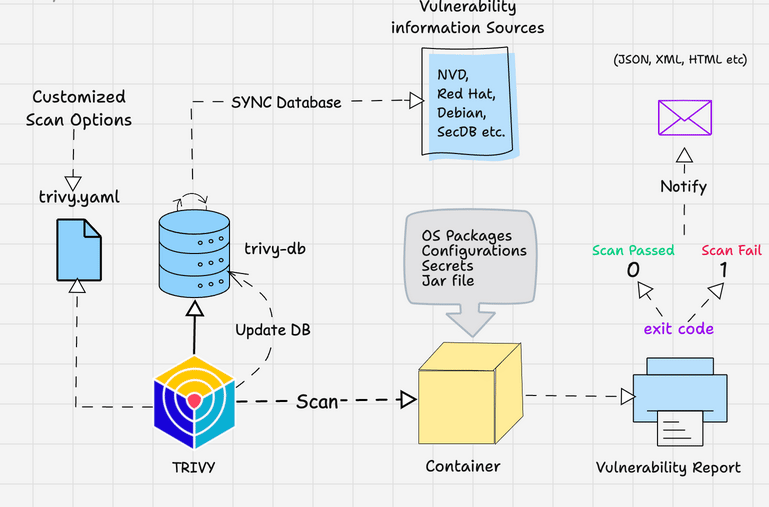
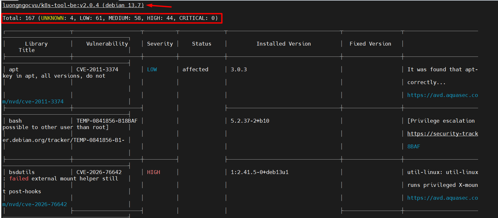
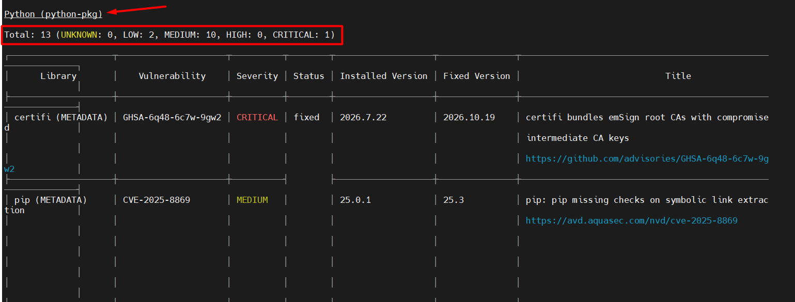

# Tìm hiểu Trivy 

## I. Trivy là gì ? 

Trivy là 1 công cụ quét bảo mật mã nguồn mở quét các lỗ hổng trong container và các tài nguyên khác. Nó có 1 db nội bộ gọi là `trivy-db` chứa thông tin về các lỗ hổng khác nhau được tạo và duy trì bởi `AquaSecurity`

Trivy cập nhật cơ sở dữ liệu của nó mỗi 6 giờ. Khi bạn bắt đầu quét, trivy tự động cập nhật cơ sở dữ liệu để bạn không cần phải theo dõi các bản cập nhật cơ sở dữ liệu.

Một tính năng quan trọng khác của Trivy là tạo SBOM. Nó cung cấp một danh sách chi tiết tất cả các thành phần được sử dụng trong phần mềm, bao gồm các thư viện mã nguồn mở và bên thứ ba.

```bash
                  TRIVY
                    │
       ┌────────────┼─────────────┐
       │            │             │
       ▼            ▼             ▼
   Vulnerability  Misconfig     Secret
       │            │             │
       ▼            ▼             ▼
      CVE        Dockerfile      API key
      CVE        K8s YAML        Password
      CVE        Terraform       Token
```

Trivy có 4 scanner chính: 

- `Vulnerability`: Tìm CVE 
- `Misconfiguration`: Tìm cấu hình không an toàn 
- `Secret`: Tìm secret bị hard-code 

## II. Cài đặt Trivy 

Cài đặt Trivy trên Ubuntu

**Bước 1:** Cài đặt các dependencies cho Trivy: 

```bash
sudo apt-get install wget apt-transport-https gnupg lsb-release
```

**Bước 2:** Tải khóa công khai và kho lưu trữ Trivy: 

```bash
wget -qO - https://aquasecurity.github.io/trivy-repo/deb/public.key | gpg --dearmor | sudo tee /usr/share/keyrings/trivy.gpg > /dev/null
echo "deb [signed-by=/usr/share/keyrings/trivy.gpg] https://aquasecurity.github.io/trivy-repo/deb $(lsb_release -sc) main" | sudo tee -a /etc/apt/sources.list.d/trivy.list
```

**Bước 3:** Cập nhật repo 

```bash
sudo apt update -y
```

**Bước 4:** Cài đặt Trivy

```bash
sudo apt install trivy
```

## III. Sử dụng Trivy để scan lỗ hổng 

Bất cứ khi nào ta chạy trivy command để quét lỗ hổng nó sẽ download cơ sở dữ liệu liên quan trước tiên và so sánh nó với các lỗ hổng được liệt kê trong cơ sở dữ liệu 

Trivy đưa ra các rủi ro về lỗ hổng: 

- `Critical`
- `High`
- `Medium`
- `Low`

Ta có thể sử dụng Trivy để quét: 

- Container images
- Filesystem 
- Remote git repo 

Trivy cũng có các tính năng thử nghiệp cho việc quét cấu hình k8s & aws 

**Workflow:** 



## IV. Scan Container Image 

Sử dụng lệnh sau để scan Docker image: 

```bash
trivy image <image-name>
```

**Ví dụ:** 

```bash
trivy image luongngocvu/k8s-tool-be:v2.0.4
```

Kết quả cho thấy có 44 lỗ hổng High và 0 lỗ hổng Critical trong image: 



Nó cũng cho thấy có 1 lỗ hổng Critical trong python package: 



### 4.0 Scan for severity 

sử dụng option `--severity <severity>` để lọc severity: 

```bash
trivy image --severity CRITICAL luongngocvu/k8s-tool-be:v2.0.4
```

### 4.1 Output dưới dạng JSON 

sử dụng option `--format json` để đưa output về dạng json 

```bash
trivy image --format json luongngocvu/k8s-tool-be:v2.0.4
```

### 4.2 Loại bỏ các lỗ hổng chưa có bản fixed 

```bash
trivy image --ignore-unfixed luongngocvu/k8s-tool-be:v2.0.4
```

## V. Trivy Scan in Docker Image Build Pipeline 

Trivy đóng vai trò quan trọng trong CICD pipeline về mặt xây dựng image Docker.

Khi sử dụng trivy trong CICD pipeline, job pipeline nên fail nếu có bất kì lỗ hổng nào trong image. Severity phụ thuộc vào từng sự tuân thủ bảo mật của từng tổ chức. 

**Ví dụ:** Ta có thể để fail job khi có cả HIGH vs Critical severity 

Hiện tại, cách tốt nhất để fail quá trình build là sử dụng exit codes 

```bash
trivy image --severity HIGH, CRITICAL --exit-code 1 luongngocvu/k8s-tool-be:v2.0.4
```

Cách tiếp cận được đề xuất là sử dụng file config Trivy để cấu hình mặc định cho 1 lần scan. 

**Ví dụ về file config trivy.yaml:** 

```yaml 
timeout: 10m
format: json
dependency-tree: true
list-all-pkgs: true
exit-code: 1
output: result.json
severity:
  - HIGH
  - CRITICAL
scan:
  skip-dirs:
    - /lib64
    - /lib
    - /usr/lib
    - /usr/include

  security-checks:
    - vuln
    - secret
vulnerability:
  type:
    - os
    - library
  ignore-unfixed: true
db:
  skip-update: false
```

```bash
trivy image --config path/to/trivy.yaml your-image-name:tag
```

## VI. Generate a Software Bill of Materials (SBOM) 

SBOM là 1 danh sách tất cả các thành phần được sử dụng trong 1 app phần mềm, như là thư viện, framework và module bao gồm cả phiên bản của chúng 

Sử dụng các command dưới đây để tạo SBOM ở định dạng CycloneDX hoặc SPDX: 

```bash
trivy image --format spdx-json --output result.json luongngocvu/k8s-tool-be:v2.0.4

trivy image --format cyclonedx --output result.json luongngocvu/k8s-tool-be:v2.0.4
```

Trivy cũng có khả năng quét các lỗ hổng bảo mật bằng file SBOM. Sử dụng lệnh sau để quét vulnerability dựa trên file SBOM:

```bash
trivy sbom result.json
```

## VII. Scan Git Repository 

Sử dụng command dưới đây để quét git repo: 

```bash
trivy repo <repo URL>
```

Nếu repo private ta cần cung cấp git token 

```bash
export GITHUB_TOKEN=,git token>

trivy repo <repo URL>
```

## VIII. Áp dụng Trivy vào CICD 


# Tài liệu tham khảo 

https://devopscube.com/scan-docker-images-using-trivy/